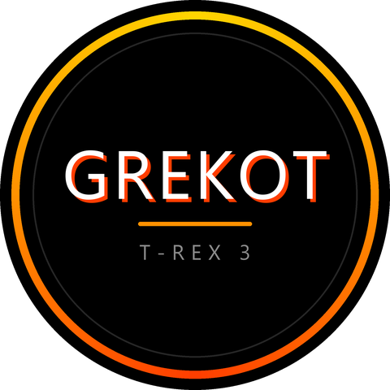

# GREKOT – aplikacja na Amazfit T-Rex 3

Pierwsza aplikacja Zepp OS: wyświetla napis **GREKOT** z cieniem 3D, pierścieniem
z gradientem (złoty → pomarańcz → czerwień) i podpisem „T-REX 3”.



> Podgląd jest przybliżony – na zegarku napis rysuje systemowa czcionka Zepp OS.

## Zegarek

| Parametr      | Wartość                          |
|---------------|----------------------------------|
| Model         | Amazfit T-Rex 3                  |
| System        | Zepp OS 4.x (API_LEVEL do 4.0)   |
| Ekran         | okrągły AMOLED, 480 × 480 px     |
| deviceSource  | 8716545, 8716547 (8716544 – Chiny) |

Aplikacja używa API 3.0 (działa na Zepp OS 3, 4 i 5) i celuje we wszystkie okrągłe
zegarki (`"st": "r"` w `app.json`).

## Struktura

```
app.json                               konfiguracja (appId, API, strony, targety)
app.js                                 cykl życia aplikacji
page/gt/home/index.page.js             strona główna – rysuje widżety
page/gt/home/index.page.r.layout.js    style/pozycje dla okrągłego ekranu
assets/gt.r/icon.png                   ikona 248 × 248
```

## Wymagania

1. [Node.js LTS](https://nodejs.org/)
2. Zeus CLI: `npm i @zeppos/zeus-cli -g`
3. Konto Zepp (to samo co w aplikacji Zepp na telefonie)

## Budowanie i instalacja na zegarku

```bash
zeus build
```

```bash
zeus preview
```

`zeus preview` przy pierwszym uruchomieniu poprosi o zalogowanie się do konta Zepp
i wybór urządzenia (T-Rex 3), a potem wyświetli w terminalu kod QR.

Na telefonie, w aplikacji Zepp:

1. **Profil → Ustawienia → O aplikacji** – stuknij 7 razy logo Zepp, aż pojawi się
   komunikat o trybie dewelopera.
2. W **Profil → Ustawienia → Tryb dewelopera** wybierz **Skanuj** i zeskanuj kod QR
   z terminala – aplikacja zainstaluje się na zegarku.

## Symulator

Do testów bez zegarka: [Zepp OS Simulator](https://docs.zepp.com/docs/guides/tools/simulator/),
a potem `zeus dev` w katalogu projektu.
