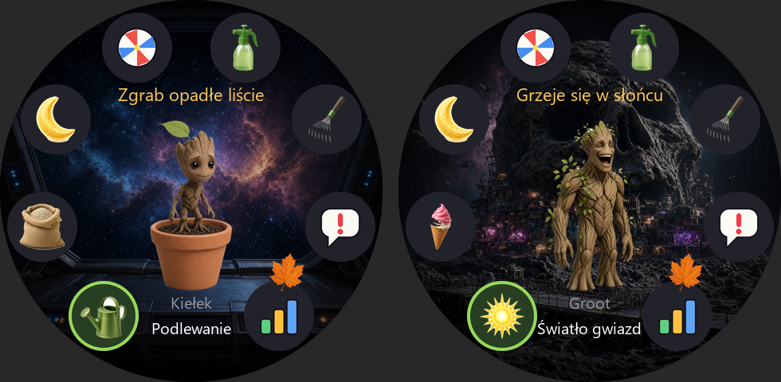
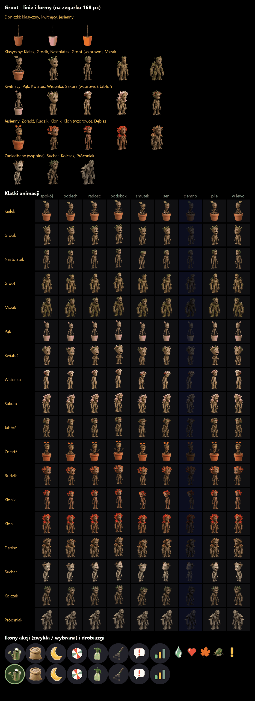

# Groot – tamagotchi z drzewkiem

Tamagotchi na Amazfit T-Rex 3: z patyczka w doniczce wyrasta stworek-drzewko w stylu
Groota. Rośnie przez kilka etapów i zmienia formę zależnie od tego, jak o niego dbasz.
To ta sama gra co [Pupil](../pupil/README.md) (wersja 1.3.0, z wszystkimi minigrami),
tylko z nowym bohaterem i nową grafiką. Tempo jest luźne – wystarczy zajrzeć 2–3 razy
dziennie. Czas płynie także przy zamkniętej aplikacji.

Grafika to realistyczne rendery z Grok Imagine (fan-art) – aplikacja jest tylko do
prywatnego użytku na własnym zegarku (`zeus preview`), nie do sklepu Zepp.



## Jak grać

Duży Groot (240 px) stoi na środku tarczy na tle miejsca z filmów, dookoła jest pierścień
ikon akcji. Komunikat jest nad jego głową, imię i nazwa wybranej akcji na dole. Stuknij
ikonę albo wybierz ją przyciskami **góra/dół** i zatwierdź przyciskiem **wyboru** (`KEY_SELECT`).

Tło zmienia się z etapem: patyczek i maluch – doniczka na konsoli w kokpicie Milano,
dziecko – pokład statku, nastolatek – jego kąt z automatem do gier, dorosły – Knowhere,
formy zaniedbane – zakurzona ładownia. W nocy przy zgaszonym świetle tło ciemnieje.

| Ikona       | Co robi |
|-------------|---------|
| Podlewanie (konewka) / Światło gwiazd (słońce) | +1 kropla wody / energii, +1 g. Najedzony odmawia. Przy słabej dyscyplinie nastolatek i dorosły czasem kręcą nosem |
| Nawóz (worek) / Lody | +1 serce humoru, +2 g (z mszycami nie chce) |
| Noc (księżyc) | od 20:00 robi się senny – zgaś światło; o 21:30 zasypia sam, o 7:30 wstaje |
| Zabawa      | minigry (jak w Pupilu); wygrana +1 humoru, każda gra −1 g |
| Oprysk      | usuwa mszyce (1–2 opryski) |
| Grabie      | zgrabia opadłe liście |
| Zgań        | gdy marudzi bez powodu: +1 dyscypliny; zganiony bez powodu się smuci |
| Statystyki  | woda albo energia, humor, dyscyplina, waga, wiek, pokolenie, błędy opieki → zmiana imienia, kolekcja form |

Podlewanie i nawóz są tylko w doniczce (patyczek, maluch). Gdy wyjdzie z doniczki, pierścień
pokazuje **Światło gwiazd** (grzeje się przy oknie statku) i **Lody** (jedyne jedzenie Groota
w filmach), a statystyki zamiast wody – energię.

Gdy nic mu nie trzeba, drzewko samo się czymś zajmuje: tańczy, wyczarowuje kwiatek na
dłoni, gra na konsoli albo wypuszcza świecące zarodniki (`utils/idle.js`).

**„Jestem Groot.”** Stuknięcie w Groota pokazuje dymek, a po chwili tłumaczenie Rocketa: czego
Groot potrzebuje (picie, słońce, mszyce, bałagan, prośba o grę), a gdy nic – coś w stylu
etapu (maluch słodki, nastolatek „zostaw mnie, gram”, dorosły „My jesteśmy Groot”) – `utils/rocket.js`.

**Groot zaczepia sam.** Gdy aplikacja jest otwarta, co 20–40 s Groot się odzywa („Jestem Groot.”
i tłumaczenie Rocketa). Gdy czegoś mu trzeba, mówi tylko o tym; gdy nic – losowo:
- zaprasza do konkretnej gry – przy nim pojawia się dymek, stuknięcie otwiera grę (delikatna
  wibracja najwyżej raz na 3 minuty);
- opowiada dowcip: najpierw pytanie, po chwili puenta (12 drzewnych kawałów);
- chwali opiekuna, mówi o podróży Milano („jeszcze 2000 kroków do Contraxii”) albo o porze dnia;
- gada w stylu etapu.

Stuknięcie w Groota daje to samo od razu. Po dłuższej przerwie (4 h, 12 h) Groot wita się po
powrocie. Prośby o konkretną grę (z premią za wygraną) przychodzą częściej niż w Pupilu – co ok.
4 godziny czuwania (ok. półtorej–dwie dziennie), a przypomnienie alarmem woła także wtedy, gdy Groot
o coś prosi, nie tylko gdy czegoś mu trzeba.

### Podróż Milano – kroki z zegarka

Przy każdym otwarciu aplikacja odczytuje dzisiejsze kroki (`Step`, uprawnienie
`data:user.hd.step`) i dopisuje przyrost (`utils/galaxy.js`):
- co 2000 kroków Groot dostaje +1 wody/energii, najwyżej 3 razy dziennie;
- wszystkie kroki pchają Milano do kolejnej planety z filmów: Xandar (6000), Contraxia (8000),
  Berhert (10 000), planeta Ego (12 000), Nidavellir (15 000), Knowhere (18 000). Po
  przylocie Groot przez dobę stoi na tle tej planety, a w kolekcji jest pocztówka; po
  Knowhere podróż zaczyna się od nowa;
- kroki z dnia, w którym aplikacja nie była otwarta, przepadają (zegarek podaje tylko dzisiejsze).

Statystyki → **Podróż ›**: kroki dzisiaj, energia, cel lotu z paskiem i 6 pocztówek (stuknij = opis).

Czasy, błędy opieki, ewolucja, odejście, przypomnienia i wyzwania (prośby o zabawę,
gra o premię po akcji, poranna rozgrzewka) działają jak w Pupilu – szczegóły w
[README Pupila](../pupil/README.md). Pod spodem „kupa” to opadłe liście, a „choroba” to mszyce.

**Ewolucja** (według błędów w kończącym się etapie):



Przy nowym patyczku wybierasz jedną z trzech doniczek (linię) i imię z listy.
Doniczka to tylko krótki początek, jak w filmach: patyczek na start i maluch (tańczący
patyczek z końca 1. części). Od dziecka (Baby Groot z 2. części) chodzi już sam.

| Doniczka      | maluch  | dziecko (0 błędów) | nastolatek (≤2) | dorosły: wzorowo (≤1 i dyscyplina ≥2) | dorosły: dobrze (≤4) |
|---------------|---------|--------------------|-----------------|---------------------------------------|----------------------|
| gliniana – klasyczny | Kiełek | Grocik | Nastolatek | Groot | Mszak |
| różowa – kwitnący | Pąk | Kwiatuś | Wisienka | Sakura | Jabłoń |
| pomarańczowa – jesienny | Żołądź | Rudzik | Klonik | Klon | Dębisz |

Zaniedbane formy są wspólne: Suchar (maluch z błędami), Kolczak (dziecko z 3+ błędami),
Próchniak (nastolatek z 5+ błędami albo Kolczak z 2+). Razem 18 form w kolekcji.

**Odejście jest łagodne**: ze starości drzewko zostawia patyczek; po długim zaniedbaniu
odchodzi do lasu. Kolekcja zdobytych form zostaje.

Minigry mają mechanikę z Pupila (22 gry, logika w `utils/games.js`, `utils/moves.js`,
`utils/walks.js`), ale motyw Strażników Galaktyki – nazwy, opisy i rekwizyty z filmów:

| Gra | Co robisz |
|-----|-----------|
| Taniec Groota | powtarzasz przechyłami jego taneczne ruchy (Powtórz ruch) |
| Części dla Rocketa | łapiesz części statku, omijasz asteroidy |
| Pilotaż Milano | przechyłami prowadzisz statek do lądowiska |
| Strzała Yondu | celujesz przechyłem w Orb, stuknięcie = gwizd |
| Balans na belce | utrzymujesz Groota na belce statku |
| Refleks | machnięcie, gdy kółko zzielenieje |
| Ryby na Knowhere | wędkowanie: podgryza, spławik nurkuje, poderwij |
| Rzut Orbem | rzut machnięciem, Groot łapie |
| Ucieczka przed Abiliskiem | skoki nad asteroidami i skrzyniami |
| Potrząśnij drzewem | strząsasz jabłka, nie ul |
| Płetwa Yondu | szukasz ruchem ręki w górę i w dół |
| Bomba Rocketa | ładujesz ruchem ręki, puść w zielonym przedziale |
| Kamień Nieskończoności | ręka w dół, po drgnięciu do góry – 3 kamienie |
| Medytacja z Mantis | 20 s bezruchu |
| Wyścig z Rocketem | bieg w miejscu szybciej niż Rocket |
| Trening z Draxem | poranna rozgrzewka |
| Łapanie sygnału | kompas: „ciepło – gorąco” |
| Wyprawa po Orb | GPS: dojdź do Orbu 200–500 m stąd |
| Nadajniki | GPS: postaw 3 nadajniki 100 m od siebie |
| Wspinaczka, Kołysanie do snu, Lewo czy prawo? | jak w Pupilu |
| Obrona Milano | **dotyk**: statki Ravagerów lecą z brzegów do Milano – stukaj je; 12 zestrzelonych, zanim 3 dolecą (45 s) |
| Awesome Mix | **dotyk + wibracja**: zegarek wystukuje rytm (krótkie i długie odstępy), ty go powtarzasz; liczą się proporcje, nie tempo; 2 z 3 rund |

Obrona Milano i Awesome Mix nie wymagają ruchu ręką – ekran cały czas jest przed oczami
(`utils/space.js`). Wibracja w Awesome Mix nie przeszkadza, bo gra nie czyta akcelerometru.

## Jak to działa

- `utils/pet.js` – stan i logika (jak w Pupilu: formy, linie `classic`/`bloom`/`autumn`,
  teksty). Stan leży w pliku `groot_state.json` w `/data` aplikacji (+ kopia `.bak`), osobno od Pupila.
- Grafika z Grok Imagine według `../groot-art/prompts.md`. Arkusze leżą w `../groot-art/`,
  poza folderem aplikacji, bo `zeus build` pakuje cały folder do `.ip-package`:
  - `<forma>_sheet.jpg` – 2×2: spokój, radość, smutek, sen,
  - `<forma>_act_sheet.jpg` – 2×2 zajęcia: taniec, kwiatek, konsola, świetliki,
  - `pots_sheet.jpg` – trzy doniczki z patyczkiem (start),
  - `bg_<scena>_sheet.jpg` – tła: kokpit, pokład, kącik, Knowhere, ładownia (przyciemniane
    przy imporcie, z wersją nocną `_n`),
  - `props_sheet.jpg` – 16 rekwizytów gier ze Strażników, `icons_sheet.jpg` – 8 ikon akcji,
    `icons2_sheet.jpg` – słońce, lody, jabłko, walkman, strzała Yondu, bomba,
  - `rocket_sheet.jpg` – Rocket, rywal w wyścigu, `ravager_sheet.png` – statek w Obronie Milano,
  - `bg_xandar/contraxia/berhert/ego/nidavellir_sheet.*` – planety podróży (Gemini, opisane bez nazw
    z filmu); z teł powstają też okrągłe pocztówki `ui/pc_<planeta>.png` (+ szara `_x`).
- Klatki Groota są w dwóch rozmiarach: `pet/` 240 px na ekran główny, `pets/` 168 px do gier
  (`spriteSrc` / `gameSprite` w `utils/ui.js`). Zab ma przez to ok. 93 MB, paczka na T-Rex 3 ok. 10,7 MB.
- `tools/grab_art.py` – warianty z Pobranych (`grootv_<nazwa>_<k>.jpg`): `--show` składa je
  w `../groot-art/_warianty.png`, `<k>` bierze wybrany; `--clip` – obraz ze schowka.
- `tools/import_art.py` wycina tło (także zamknięte białe dziury między rękami a tułowiem),
  wyrównuje miny wspólną skalą i robi klatki; `tools/preview_art.py` – podgląd.
- `tools/gen_assets.py` – całość: drobiazgi (strzałki, serca, krążki pierścienia), import
  wszystkich arkuszy, `utils/geometry.js`, `docs/arkusz.png`, `docs/podglad.png`, ikona aplikacji.
- `tools/smoke.mjs` – smoke test prawdziwych bundli zeusa w Node `vm` (bundle przechwytuje
  `tools/capture-hook.cjs`).

```bash
npm install
npm test                     # testy logiki w Node
python tools/gen_assets.py   # po zmianie grafiki (importuje arkusze z ../groot-art)
zeus preview                 # instalacja na zegarku
```

## Niesprawdzone na zegarku

Wszystko, co niesprawdzone w Pupilu (progi ruchu w minigrach, `KEY_SELECT`, alarm
przypomnienia), a do tego wygląd realistycznych renderów w 168 px na ekranie zegarka.
