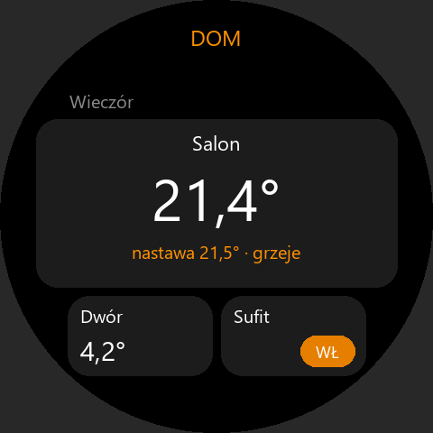
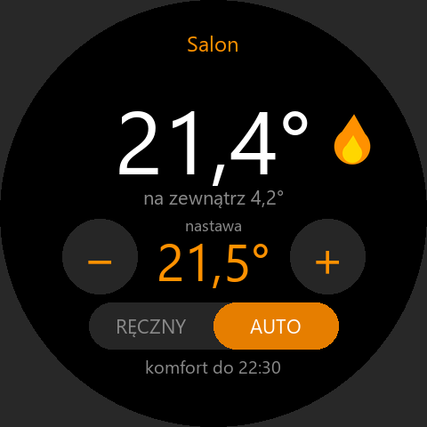

# HomeAutomation

Jedna aplikacja dla urządzeń domowych: na start termostat SmartTermostatOLED (ESP32-S3, kocioł gazowy),
potem światła (własne węzły ESP32, Shelly, Sonoff, Tuya przez hub ESP32).

| Folder | Co to jest |
|---|---|
| [phone](phone/README.md) | aplikacja Flutter na telefon (`pl.grekot.homeautomation`) i atrapy urządzeń do testów |
| `watch` | aplikacja Zepp OS „Dom” na zegarek (niżej) |

Firmware, kontrakt API v2 (`docs/API.md`) i konfiguracja Firebase (`docs/firebase/`) są w repozytorium
`grekot/SmartTermostatOLED` (lokalnie `C:\TMP\My_GIT\Termostat\SmartTermostatOLED`).

## Telefon (`phone/`)

- **W domu** telefon rozmawia z urządzeniami bezpośrednio: HTTP i WebSocket, wykrywanie przez mDNS `_homeauto._tcp`.
- **Spoza domu** przez Firebase Realtime Database (projekt `zakupy-8ec54`, to samo konto co Zakupy i Powrót).
- **Nowe urządzenie** dodaje się przez Bluetooth: aplikacja przekazuje mu sieć WiFi i od razu je paruje,
  bez aplikacji Espressifa. Kolejne telefony parują się kodem z ekranu urządzenia.
- **Domy i domownicy**: właściciel zaprasza kodem i ustala poziomy `view` / `control` / `config` na urządzenie.
- **Pulpity** prywatne i wspólne (widżety z `describe`, sceny `homes/{h}/scenes`), osobny **pulpit zegarka**
  z podglądem w kształcie ekranu oraz kafelki urządzeń w pokojach (`homes/{h}/rooms`, wspólne dla telefonów i zegarka).
- **Chmura bez hasła w urządzeniu**: urządzenie zakłada anonimowe konto Firebase, a aplikacja właściciela przypisuje je
  do domu (w konsoli trzeba włączyć logowanie anonimowe).
- **Powiadomienia** o awarii czujnika i braku kontaktu (WorkManager, bez Cloud Functions).
- Wydanie do Sklepu rodzinnego: tag `homeautomation-vX.Y.Z`.

Szczegóły, uruchomienie i testy: [phone/README.md](phone/README.md).

## Zegarek (`watch/`)

Aplikacja Zepp OS **„Dom”** na Amazfit T-Rex 3 (appId 1087170, API 3.0). Tylko przez chmurę
(SmartTermostatOLED `docs/API.md`, pkt 8, 12, 13a), tak jak Na szczycie: Side Service w aplikacji Zepp na telefonie
loguje się REST-em kontem osoby (e-mail i hasło w ustawieniach aplikacji w Zepp) i czyta Realtime Database
– **tylko gdy aplikacja na zegarku jest otwarta** (co ~5 s). W tle nic się nie dzieje
(powiadomienia o awariach przychodzą z aplikacji na telefonie).

| Pulpit | Termostat |
|---|---|
|  |  |

**Dom**: domy osoby z `users/{uid}/homes`; przy kilku domach wybór w ustawieniach w Zepp
(„Dom na zegarku”, lista pojawia się po pierwszym otwarciu aplikacji na zegarku), inaczej pierwszy.

**Zgłoszenie zegarka**: przy każdym uruchomieniu Side Service zapisuje `users/{uid}/watches/{deviceSource}`
(nazwa modelu, `width`, `height`, `shape`, wersja aplikacji, `lastSeen`) – telefon wie, pod jaki ekran układać pulpit.

**Pulpit zegarka** (`page/gt/home`, pkt 13a): `users/{uid}/watchDashboards/{homeId}/{deviceSource}`, układany na
telefonie (ekran „Zegarek”) osobno od pulpitów telefonu – tych zegarek nie pokazuje. Strony leżą jedna pod drugą
(przewijanie pionowe, nagłówek strony), kafelki w wierszach: `half` (dwa obok siebie), `full`, `big` (podwójna
wysokość). Na okrągłym ekranie szerokość wiersza to cięciwa koła w miejscu, do którego wiersz da się przewinąć –
kafelki na samej górze i na dole treści są węższe (`utils/layout.js`). Widoki:
- **thermostat**: temperatura, „nastawa 21,5° · grzeje”, na czerwono „Brak kontaktu” / „Awaria czujnika”,
  w rogu znacznik ochrony z `State.protect`: „MRÓZ” (wyłączony, pilnuje temperatury przeciwmrozowej) albo
  czerwone „AWARYJNIE” (awaria czujnika, grzanie awaryjne); dotknięcie otwiera ekran termostatu.
- **toggle**: WŁ / WYŁ, przy ściemniaczu „jasność 80%”; dotknięcie przełącza (Set `{"on": …}`), do potwierdzenia
  napis na pigułce jest szary.
- **stepper**: wartość z − / + w kafelku (`full`, `big`; zakres i krok z `describe`, nastawa 15–30 co 0,5),
  naciśnięcia zbierane, jedno polecenie po 1 s bez dotyku; w `half` sama wartość.
- **value** / **status**: punkt stanu (także zagnieżdżony, np. `outdoor.temp`) z nazwą i jednostką z `describe`
  (pkt 14); status jako „tak/nie” („grzeje”).
- **scene** (`sceneId` → `homes/{homeId}/scenes/{id}`): ▶ – gdy w domu jest hub (urządzenie `info.type == "hub"`,
  którym osoba steruje), jedno polecenie `{"runScene": id}` do huba; bez huba zegarek wysyła akcje `set` po kolei
  (tylko do urządzeń, którymi osoba steruje) i zatrzymuje się na pierwszym `delay` – wtedy komunikat
  „wysłano część”. Domownik uruchamia scenę przez hub, gdy ma na nim `control`; inaczej zegarek wysyła akcje sam,
  z poziomem domownika dla każdego urządzenia.
- Kafelki urządzeń bez dostępu są pomijane. Bez pulpitu zegarka – urządzenia z dostępem, strona na pokój
  (`homes/{homeId}/rooms`, reszta w „Inne”).

**Uprawnienia** (`homes/{homeId}/access/{uid}`, pkt 12; właściciel domu ma `config` wszędzie): przy `view`
kafelek włącznika pokazuje sam stan, a ekran termostatu nie ma − / + ani zmiany trybu. Polecenia idą
z `"by": uid`; odpowiedź `forbidden` urządzenia pokazuje się jako „Brak uprawnień”.

**Termostat** (`page/gt/thermostat`): duża temperatura, płomień przy grzaniu, temperatura na zewnątrz;
nastawa − / + co 0,5 °C (15–30), także przyciskami zegarka góra/dół – naciśnięcia są zbierane i idzie
jedno polecenie po 1 s bez dotyku (+ i − z powrotem nic nie wysyła, bo w AUTO włączyłoby nadpisanie);
tryb RĘCZNY | AUTO, w AUTO „komfort/eko do HH:MM” albo pomarańczowe „nadpisane do HH:MM”;
ostrzeżenia „Brak kontaktu · N min temu” (`lastSeen` starsze niż 3 min), „Awaria czujnika”.

Polecenia: `POST commands/{homeId}/{id}.json` z `{"values", "ts": {".sv":"timestamp"}, "by": uid, "source": "watch"}`
(`by` = uid zalogowanej osoby – wymagają tego reguły),
potwierdzenie z `homes/{homeId}/devices/{id}/lastCommand.key` („Zapisano”, „Błąd: nastawa poza zakresem”, „Brak uprawnień”,
„Polecenie wygasło”, „Urządzenie zajęte”; po 30 s bez odpowiedzi „Brak potwierdzenia”).
Odczyt: raz na minutę dom, uprawnienia, pulpit zegarka, pokoje, sceny, lista urządzeń z `homes/{homeId}/deviceIndex`
(`{id: {type, name}}`, czytelna dla domowników; urządzenia bez dostępu pomijane) i (dla kafelków punktów) `describe`;
`info` i `config/name` tylko dla urządzeń bez typu lub nazwy w indeksie. Dom bez `deviceIndex`: właściciel czyta
listę `devices` płytko, domownik zna urządzenia z `access` (przy `_all` także z pokoi i pulpitu zegarka);
co obieg `state` + `lastSeen` urządzeń z ekranu; `lastCommand` tylko przy czekaniu na potwierdzenie.
Historii (`history/{homeId}/{id}`) zegarek nie czyta.

Konfiguracja Firebase (klucz API i `databaseURL` z `phone/android/app/google-services.json`, klient
`pl.grekot.homeautomation`; plik `watch/utils/firebase-config.js` jest poza gitem, bez `google-services.json`
powstaje zaślepka i zegarek pokazuje „Brak konfiguracji”):

```bash
cd homeautomation/watch && npm install && node tools/configure_watch.mjs
```

Instalacja na zegarku:

```bash
cd homeautomation/watch && zeus preview
```

(wybierz „Amazfit T-Rex 3”, potem w Zepp: Profil → urządzenie → Ogólne → Tryb dewelopera → „+” → Skanuj).
Potem w Zepp: Profil → urządzenie → Aplikacje → Dom → Ustawienia – zaloguj się e-mailem i hasłem.

Testy: `npm test` w `homeautomation/watch` (czyste funkcje w `utils/`: adresy REST, uprawnienia, dekodowanie
pulpitu zegarka, układ kafelków w wierszach na okrągłym i kwadratowym ekranie, zgłoszenie zegarka, logika
termostatu, obieg Side Service na udawanej bazie z regułami właściciela i domownika).
Test dymny prawdziwych bundli w Node `vm`: opis na początku `tools/smoke.mjs`. Ikona i podglądy:
`python tools/gen_assets.py`.

Niesprawdzone na zegarku: wszystko poza buildem i testami w Node (wygląd, przewijanie listy, odczyt
przez telefon, czasy odpowiedzi BLE, zachowanie przy wygaszonym ekranie).
