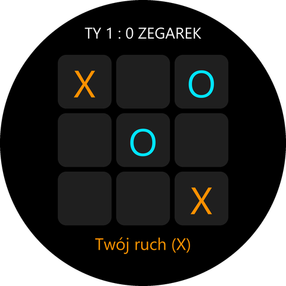

# Kółko i krzyżyk – gra na Amazfit T-Rex 3

Klasyczne kółko i krzyżyk na okrągłym ekranie zegarka. Grasz krzyżykiem (X)
przeciwko zegarkowi (O) albo we dwoje na jednym zegarku.



## Zasady obsługi

| Gest                              | Działanie                                   |
|-----------------------------------|---------------------------------------------|
| stuknięcie w puste pole           | postawienie znaku                           |
| stuknięcie po zakończonej partii  | nowa partia (zaczyna druga strona)          |
| stuknięcie w wynik u góry         | zmiana trybu: zegarek ↔ dwóch graczy (zeruje wynik) |

Wygrywająca linia podświetla się kolorem zwycięzcy, a zegarek krótko wibruje.

## Jak gra zegarek

Logika jest w [utils/game.js](utils/game.js) i nie zależy od UI. Zegarek wybiera ruch
według prostych reguł: wygraj → zablokuj → środek → róg → cokolwiek. Celowo nie
przewiduje „widełek”, więc da się go pokonać.

Testy logiki (wymagają tylko Node.js, nie zegarka):

```bash
node test/game.test.mjs
```

W symulacji zegarek wygrywa z losowym graczem ~90% partii, a zegarek kontra zegarek
zawsze remisuje.

## Budowanie i instalacja

W tym folderze:

```bash
zeus preview
```

Potem w aplikacji Zepp: **Urządzenie → Ogólne → Tryb dewelopera → „+” → Skanuj**.
