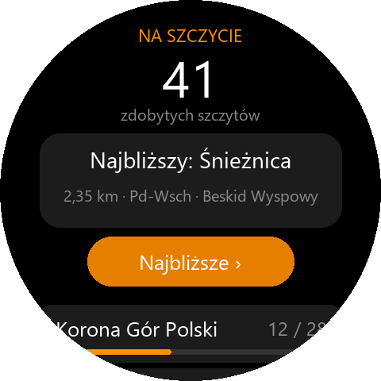
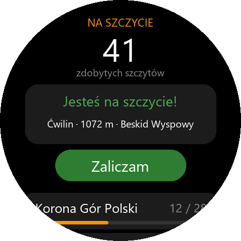
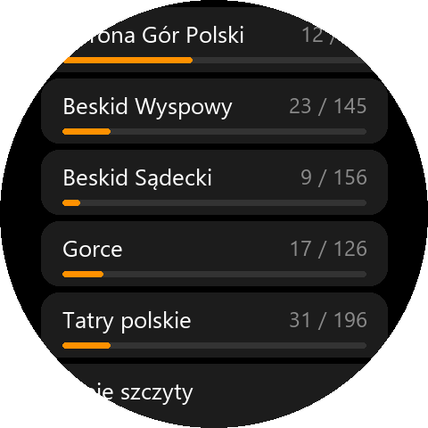
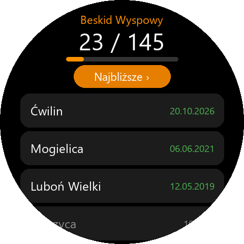
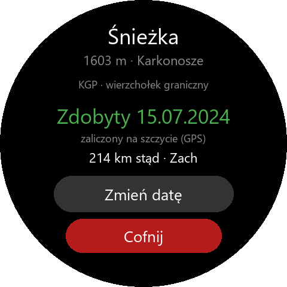
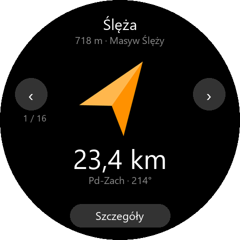
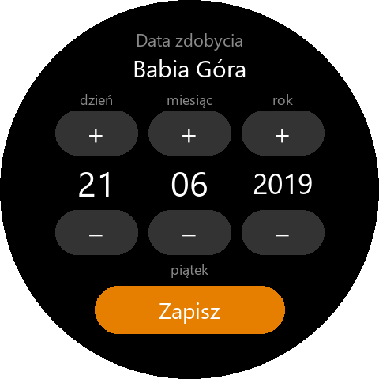
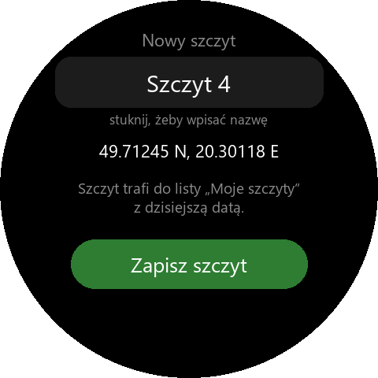

# Na szczycie – zdobyte szczyty

*(folder i nazwy wewnętrzne zostały `korona` – aplikacja nazywała się tak w wersji 1.0)*

Aplikacja na zegarek (Zepp OS, Amazfit T-Rex 3 i inne okrągłe) do zbierania szczytów
z kilku list: **Korona Gór Polski** (28), **Beskid Wyspowy**, **Beskid Sądecki**,
**Gorce** i **Tatry polskie** (wszystkie szczyty z Wikipedii, razem 652) oraz **Moje
szczyty**, czyli wierzchołki spoza list dodane ręcznie. Gdy stoisz na szczycie, zegarek
rozpoznaje go po GPS, wibruje i pokazuje **„Jesteś na szczycie!”** z przyciskiem
**Zaliczam**, który zapisuje dzisiejszą datę. Pokazuje też postęp każdej listy, szczyty
z datami zdobycia i najbliższe niezdobyte ze strzałką kompasu. Działa bez telefonu
i bez internetu. Po zalogowaniu zdobycia trafiają do aplikacji Na szczycie na telefonie.

| Ekran główny | Na szczycie | Listy |
|:---:|:---:|:---:|
|  |  |  |
| **Lista pasma** | **Szczegóły** | **Najbliższe** |
|  |  |  |
| **Data zdobycia** | **Dodaj szczyt tutaj** | |
|  |  | |

*(podglądy rysowane w Pillow, nie zrzuty z zegarka)*

## Ważne: otwórz aplikację na szczycie

Mini-aplikacja Zepp OS **nie działa w tle**. Zegarek nie zauważy szczytu, jeśli
aplikacja jest zamknięta – trzeba ją otworzyć na wierzchołku (albo chwilę przed nim).
Po wygaszeniu ekranu i podniesieniu ręki wraca ta sama strona (GPS nie startuje od zera).
Szczyt, na którym byłeś bez otwartej aplikacji, dodasz ręcznie z datą.

## Ekrany

- **Ekran główny** – liczba zdobytych szczytów, karta GPS i pod nią listy z postępem
  („23 / 145” i pasek). Karta pokazuje kolejno: „Szukam GPS…”, najbliższy niezdobyty
  szczyt ze wszystkich list z odległością i kierunkiem albo – na wierzchołku – „Jesteś
  na szczycie!” i przycisk **Zaliczam**. Niżej **+ Dodaj szczyt tutaj** i stan wysyłania
  do telefonu.
- **Lista** (stuknięcie w listę) – postęp, **Najbliższe ›** w tej liście i wszystkie
  szczyty: najpierw zdobyte (najnowsze na górze, z datą), potem niezdobyte od
  najwyższego. Warianty KGP są na końcu z dopiskiem „war.”.
- **Szczegóły szczytu** – wysokość, pasmo, listy, do których należy (np. „KGP · Tatry”),
  uwagi, data zdobycia, czy zaliczony przez GPS, czy dodany ręcznie, odległość od Ciebie.
  Przyciski: niezdobyty → **Prowadź** / **Dodaj datę**; na szczycie → **Zaliczam** /
  **Inna data**; zdobyty → **Zmień datę** / **Cofnij** (z potwierdzeniem). Własny
  szczyt: **Usuń**, a stuknięcie w nazwę ją zmienia (gdy zegarek ma klawiaturę).
- **Najbliższe** – niezdobyte szczyty od najbliższego (ze wszystkich list albo z jednej),
  strzałka kompasu jak w aplikacji Powrót, odległość i kierunek. Celem jest zawsze
  najbliższy szczyt; **‹ ›** przełącza na kolejny. „Prowadź” w szczegółach prowadzi do
  jednego wybranego szczytu.
- **Data zdobycia** – dzień / miesiąc / rok przyciskami + i −, stuknięcie w rok cofa
  o 10 lat, dzień tygodnia dla kontroli, **Zapisz**. Daty z przyszłości są blokowane.
- **Dodaj szczyt tutaj** – zapisuje wierzchołek spoza list w miejscu, w którym stoisz
  (GPS), z dzisiejszą datą. Nazwę wpiszesz z klawiatury zegarka, jeśli ją ma; inaczej
  dostaje nazwę „Szczyt N”. Jeśli stoisz na szczycie z listy, aplikacja podpowie, żeby
  zaliczyć ten szczyt, zamiast dodawać nowy. Własne szczyty też są potem rozpoznawane.

## Listy pasm: Beskid Wyspowy, Beskid Sądecki, Gorce, Tatry polskie

| Lista | Szczytów | Źródło przynależności |
|---|---:|---|
| Beskid Wyspowy | 145 | [Kategoria:Szczyty Beskidu Wyspowego](https://pl.wikipedia.org/wiki/Kategoria:Szczyty_Beskidu_Wyspowego) (+ podkategorie Mogielica, Łopień, Luboń Wielki) |
| Beskid Sądecki | 156 | [Kategoria:Szczyty Beskidu Sądeckiego](https://pl.wikipedia.org/wiki/Kategoria:Szczyty_Beskidu_S%C4%85deckiego) |
| Gorce | 126 | [Kategoria:Szczyty Gorców](https://pl.wikipedia.org/wiki/Kategoria:Szczyty_Gorc%C3%B3w) |
| Tatry polskie | 196 | [Kategoria:Szczyty polskich Tatr](https://pl.wikipedia.org/wiki/Kategoria:Szczyty_polskich_Tatr) (z granicznymi, np. Rysy) |

- **Skład list** to wszystkie szczyty, które polska Wikipedia zalicza do pasma –
  także drobne wierzchołki grzbietów. Strony o całych pasmach („Pasmo …”) są pominięte.
  Tatry to strona polska z wierzchołkami granicznymi; szczytów leżących całkiem
  na Słowacji nie ma. Giewont jest jako „Wielki Giewont” (strona „Giewont” opisuje masyw).
- **Współrzędne** z węzła OSM `natural=peak` dopasowanego po id Wikidata albo po nazwie
  (do 1,5 km od współrzędnych z Wikipedii); dla 57 szczytów bez węzła OSM – z Wikipedii
  (dokładność do sekundy, ok. 30 m).
- **Wysokość** z infoboksu Wikipedii, a gdy jej brak – z OSM (18 szczytów bez wysokości).
- Szczyt może być na kilku listach: Rysy (KGP + Tatry), Turbacz (KGP + Gorce),
  Radziejowa (KGP + Sądecki), Mogielica i Lubomir (KGP + Wyspowy). Jedno zdobycie
  liczy się na każdej z nich.
- Nazwy się powtarzają (np. 7 × Kiczora) – w szczegółach widać wysokość i pasmo.
- Dane odświeża `node tools/fetch_peaks.mjs` (pobiera na nowo z Wikipedii i OSM; surowe
  odpowiedzi w `%TEMP%\korona-cache`, `--refresh` od zera), a potem
  `node tools/build_watch_data.mjs`. Zestawienie, które szczyty mają współrzędne z Wikipedii
  lub zostały pominięte, wypisuje `fetch_peaks.mjs`.

## Lista: Korona Gór Polski (28 szczytów)

Aplikacja używa listy **Klubu Zdobywców Korony Gór Polski** – tej, na którą zbiera się
pieczątki do odznaki. Pierwsza wersja z 1997 r. („Poznaj Swój Kraj”) miała 27 szczytów;
potem dodano Ślężę, w Pieninach Wysoką zamiast Trzech Koron, a w Górach Bialskich
Rudawiec zamiast Postawnej. W tej postaci (28) lista obowiązuje do dziś, mimo że nowsze
pomiary wskazują w kilku pasmach inny najwyższy punkt.

| # | Szczyt | m n.p.m. | Pasmo |
|---:|---|---:|---|
| 1 | Rysy | 2499 | Tatry |
| 2 | Babia Góra (Diablak) | 1725 | Beskid Żywiecki |
| 3 | Śnieżka | 1603 | Karkonosze |
| 4 | Śnieżnik | 1423 | Masyw Śnieżnika |
| 5 | Tarnica | 1346 | Bieszczady |
| 6 | Turbacz | 1310 | Gorce |
| 7 | Radziejowa | 1266 | Beskid Sądecki |
| 8 | Skrzyczne | 1257 | Beskid Śląski |
| 9 | Mogielica | 1171 | Beskid Wyspowy |
| 10 | Wysoka Kopa | 1126 | Góry Izerskie |
| 11 | Rudawiec | 1106 | Góry Bialskie |
| 12 | Orlica | 1084 | Góry Orlickie |
| 13 | Wysoka (Wysokie Skałki) | 1050 | Pieniny |
| 14 | Wielka Sowa | 1015 | Góry Sowie |
| 15 | Lackowa | 997 | Beskid Niski |
| 16 | Kowadło | 989 | Góry Złote |
| 17 | Jagodna | 977 | Góry Bystrzyckie |
| 18 | Skalnik | 945 | Rudawy Janowickie |
| 19 | Waligóra | 936 | Góry Kamienne |
| 20 | Czupel | 931 | Beskid Mały |
| 21 | Szczeliniec Wielki | 919 | Góry Stołowe |
| 22 | Lubomir | 904 | Beskid Makowski |
| 23 | Biskupia Kopa | 889 | Góry Opawskie |
| 24 | Chełmiec | 850 | Góry Wałbrzyskie |
| 25 | Kłodzka Góra | 765 | Góry Bardzkie |
| 26 | Skopiec | 724 | Góry Kaczawskie |
| 27 | Ślęża | 718 | Masyw Ślęży |
| 28 | Łysica | 614 | Góry Świętokrzyskie |

### Warianty

Część osób chodzi też na „prawdziwie najwyższe” wierzchołki albo na te z pierwszej
wersji listy. Aplikacja je **rozpoznaje i zapisuje**, ale **nie liczą się do 28** (do
odznaki KZKGP liczy się szczyt z listy). Są na dole listy pod nagłówkiem „Warianty”.

| Wariant | m | Zamiast | Dlaczego |
|---|---:|---|---|
| Borowa | 853 | Chełmiec | faktycznie najwyższa w Górach Wałbrzyskich (Chełmiec był mierzony z wieżą) |
| Szeroka Góra | 766 | Kłodzka Góra | wg nowszych pomiarów wyższa |
| Okole | 725 | Skopiec | wg pomiarów z 2021 r. wyższe |
| Agata | 614 | Łysica | wschodni, najwyższy wierzchołek Łysicy (potwierdzone 2019) |
| Postawna | 1117 | Rudawiec | na pierwszej liście z 1997 r. |
| Trzy Korony | 982 | Wysoka | na pierwszej liście z 1997 r. |

**Barania Góra** (zamiast Skrzycznego) i **Wysoki Kamień** (zamiast Wysokiej Kopy)
nie są wariantami KGP – nie znalazłem źródła, które by je tak traktowało. Barania Góra
należy do osobnej odznaki *Korona Beskidu Śląskiego*. Dlatego ich nie dodałem.

### Skąd dane

- Skład listy i wysokości: Wikipedia, hasło
  [Korona Gór Polski](https://pl.wikipedia.org/wiki/Korona_G%C3%B3r_Polski)
  (wersja z 20.10.2026, CC BY-SA 4.0) – zgodne z listą Klubu Zdobywców KGP.
- Współrzędne wierzchołków: [OpenStreetMap](https://www.openstreetmap.org/), węzły
  `natural=peak` (© współtwórcy OpenStreetMap, licencja ODbL), pobrane 20.10.2026 przez
  Overpass API i Nominatim. Id węzła każdego szczytu jest w polu `osm` w
  [watch/utils/kgp.js](watch/utils/kgp.js) i w `data/peaks.json` – można go podejrzeć pod adresem
  `https://www.openstreetmap.org/node/<id>`.

## Kiedy zegarek uznaje, że jesteś na szczycie

**Do 120 m od wierzchołka, przez 2 kolejne odczyty GPS.** Dlaczego tyle:

- GPS zegarka w lesie myli się o 10–30 m, a węzeł szczytu w OSM bywa przesunięty o
  kilkanaście–kilkadziesiąt metrów;
- wiele szczytów to płaskie, zalesione kopuły (Lubomir, Jagodna, Kłodzka Góra, Łysica,
  Mogielica), gdzie szlak mija najwyższy punkt o kilkadziesiąt metrów; 120 m na
  grzbiecie o nachyleniu 5–10% to 6–12 m poniżej wierzchołka – nadal „na szczycie”;
- **gdzie wierzchołki stoją gęsto** (Tatry, grzbiety Beskidów) promień szczytu jest
  zmniejszany do połowy odległości od najbliższego sąsiada, ale nie mniej niż 40 m
  (dotyczy 58 szczytów). Strefy się więc nie nakładają, a przejście granią na sąsiedni
  wierzchołek też wymaga 2 odczytów. Wyjątek: 13 par bliżej niż 80 m (np. Granaty –
  Zadni Granat); tam wygrywa bliższy wierzchołek, a drugi można zaliczyć w szczegółach.

Wyjście ze szczytu liczy się dopiero 80 m za jego promieniem (żeby komunikat nie migał),
a dwa odczyty z rzędu chronią przed pojedynczym skokiem GPS. Wartości są w
[watch/utils/korona.js](watch/utils/korona.js) (`SUMMIT_RADIUS_M`, `LEAVE_EXTRA_M`,
`CONFIRM_FIXES`) i w [tools/fetch_peaks.mjs](tools/fetch_peaks.mjs) (`RADIUS`, `MIN_RADIUS`).

## Instalacja

Raz, po pobraniu repozytorium (tworzy plik z kluczem Firebase, który nie jest w gicie –
bierze go z aplikacji Powrót albo z `phone/android/app/google-services.json`):

```bash
cd korona
node tools/configure_watch.mjs
```

Potem jak zwykle:

```bash
cd korona/watch
npm install
zeus preview
```

Dalej jak przy innych aplikacjach (główny [README](../README.md)): wybierz Amazfit
T-Rex 3, zeskanuj kod QR w aplikacji Zepp (Tryb dewelopera → „+” → Skanuj).

Uprawnienia: lokalizacja, kompas, pamięć zegarka, informacje o urządzeniu. API 3.0
(Zepp OS 3 i nowsze).

## Telefon

Aplikacja **Na szczycie** na Androida w [`phone/`](phone/README.md) (Flutter, `pl.grekot.naszczycie`) pokazuje
zdobycia z zegarka: postęp każdej listy („12 / 28” z paskiem), listy szczytów z datami,
szczegóły szczytu, mapę (OpenTopoMap / OpenStreetMap, zdobyte na zielono) i historię wejść
po latach, także własne szczyty. Logowanie tym samym kontem co Zakupy i Powrót; dane czyta z
Firestore (`korona/{uid}`, patrz [SYNC.md](SYNC.md)) – zapisuje je zegarek. Bez zegarka
można obejrzeć przykładowe dane (menu ⋮).

### Konto na zegarku i wysyłanie

Logowanie na zegarku: aplikacja Zepp → zegarek → **Na szczycie** → ustawienia (to samo
konto, e-mail i hasło). Po zalogowaniu zegarek wysyła cały zapis (zdobycia i własne
szczyty) do dokumentu `korona/{uid}`.

- Wysyłanie działa, gdy aplikacja jest otwarta na zegarku, a telefon połączony z zegarkiem.
  Jeśli się nie uda, zegarek próbuje ponownie co minutę. Stan widać na dole ekranu głównego.
- Zegarek jest źródłem prawdy – telefon tylko pokazuje.
- Po ponownej instalacji aplikacji na zegarku (pusty zapis) zdobycia wracają z chmury.
- Bez logowania wszystko działa tylko na zegarku.

## Pamięć

LocalStorage zegarka: `korona_climbs` = `{ "rysy": { "d": "2024-07-15", "gps": true }, ... }`,
`korona_custom` = własne szczyty `{ "c<ms>": { "name", "lat", "lon", "d", "gps" } }`,
`korona_dirty` (zmiany do wysłania), `korona_synced` (była synchronizacja).

## Dla programisty

```
watch/                   aplikacja na zegarek (projekt zeus - tylko z tego folderu `zeus build`)
  app.json               appId 1087166, strony, uprawnienia, Side Service, ustawienia
  page/gt/home/          ekran główny: liczba zdobyć, karta GPS, listy, stan telefonu
  page/gt/group/         jedna lista (SCROLL_LIST)
  page/gt/peak/          szczegóły szczytu, Zaliczam / Cofnij / Usuń
  page/gt/date/          wybór daty zdobycia
  page/gt/nearest/       najbliższe niezdobyte + strzałka kompasu
  page/gt/add/           dodaj szczyt tutaj
  app-side/              Side Service: logowanie Firebase, zapis korona/{uid}
  setting/               ustawienia w aplikacji Zepp (logowanie)
  utils/peaks-data.js    WYGENEROWANE z data/peaks.json
  utils/peaks.js         listy, szczyty, własne szczyty
  utils/kgp.js           28 szczytów KGP + warianty (źródło dla fetch_peaks.mjs)
  utils/korona.js        rozpoznanie szczytu, najbliższe, postęp, daty (czyste funkcje)
  utils/store.js         zapis w LocalStorage
  utils/sync.js          wysyłanie do telefonu, przywracanie
  utils/firestore.js     zapytania REST Firestore (czyste funkcje)
  utils/geo.js, sensors.js, input.js  z aplikacji Powrót
  test/*.test.mjs        testy Node: npm test
phone/                   aplikacja na telefon (Flutter) - wizualizacja zdobyć
data/peaks.json          wspólna lista szczytów dla zegarka i telefonu (WYGENEROWANE)
SYNC.md                  kontrakt danych zegarek <-> telefon (peaks.json, Firestore)
tools/fetch_peaks.mjs    Wikipedia + OSM -> data/peaks.json
tools/build_watch_data.mjs  data/peaks.json -> watch/utils/peaks-data.js
tools/configure_watch.mjs   watch/utils/firebase-config.js (poza gitem)
tools/gen_assets.py      ikona, strzałka i podglądy (Pillow)
docs/                    podglądy ekranów
```

Testy (w `watch/`): `npm test` – dane list (liczby, scalenie KGP z pasmami, strefy
rozpoznania), rozpoznanie z histerezą i przejściem granią, najbliższe, postęp, daty,
własne szczyty, zapis i odczyt dokumentu Firestore.

Pomysły na później: kolejne pasma (Beskid Żywiecki, Pieniny, Bieszczady…) – wystarczy
dopisać grupę z kategorią Wikipedii w `GROUPS` w `tools/fetch_peaks.mjs`.
