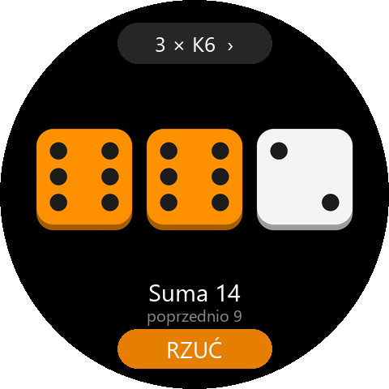
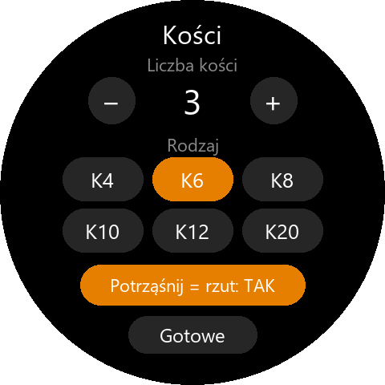

# Kości – kości do planszówek na Amazfit T-Rex 3

Od 1 do 6 kości na nadgarstku: zwykłe K6 z oczkami albo K4, K8, K10, K12, K20 do gier
fabularnych. Rzucasz przyciskiem na ekranie, przyciskiem zegarka albo potrząśnięciem.

| Stół                              | Ustawienia                                         |
|-----------------------------------|----------------------------------------------------|
|       |          |

## Obsługa

| Gest                                    | Działanie                                              |
|-----------------------------------------|--------------------------------------------------------|
| **RZUĆ** na dole                        | rzut (kości toczą się ok. 0,7 s, na końcu wibracja)   |
| przycisk góra / dół zegarka             | rzut – wygodne w rękawiczkach                          |
| potrząśnięcie zegarkiem                 | rzut (można wyłączyć w ustawieniach)                   |
| stuknięcie w kość                       | zatrzymanie (pomarańczowa) – przy następnym rzucie zostaje, jak w Generale / Yahtzee |
| przycisk u góry („2 × K6 ›”)            | ustawienia: liczba kości, rodzaj, potrząsanie          |

Pod kośćmi: **suma**, „**Dublet!**” przy dwóch takich samych (Eurobiznes, Monopoly),
„**Wszystkie 5!**” przy 3+ takich samych, „**Maksimum!**” przy 20 na K20, oraz wynik
poprzedniego rzutu.

Ostatni rzut zostaje w pamięci: gdy ekran zgaśnie między turami, po podniesieniu ręki
wraca ta sama strona z tym samym wynikiem.

## Technicznie

| Plik | Co robi |
|---|---|
| `utils/dice.js` | rzut z zatrzymanymi kośćmi, podsumowanie, oczka K6, rozmieszczenie kości, wykrywanie potrząśnięcia |
| `utils/store.js` | ustawienia i ostatni rzut w pamięci zegarka |
| `utils/device.js` | akcelerometr, wibracja, wybudzanie do tej samej strony |
| `page/gt/home` | stół z kośćmi |
| `page/gt/setup` | ustawienia |
| `tools/gen_assets.py` | ikona i podglądy do README (Pillow) |

Kości są rysowane widżetami (`FILL_RECT` + `CIRCLE` na oczka), bez obrazków – ostre
w każdym rozmiarze, także na Active 2 (466 px). Losowanie: `Math.random()`, każda
ścianka tak samo prawdopodobna (sprawdzane w testach).

Potrząśnięcie = co najmniej 3 odczyty akcelerometru odbiegające od 1 g o ponad 0,9 g
w ciągu 0,7 s, potem 1,5 s przerwy (`SHAKE` w `utils/dice.js`). Pojedyncze machnięcie
ręką nie rzuca. Akcelerometr działa tylko wtedy, gdy potrząsanie jest włączone.

API 3.0; uprawnienia: pamięć, akcelerometr.

## Testy

```bash
npm test
```

## Instalacja

```bash
zeus preview
```

→ wybierz zegarek → skan w aplikacji Zepp (Urządzenie → Ogólne → Tryb dewelopera → „+” → Skanuj).
