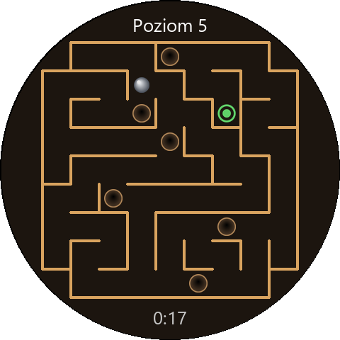
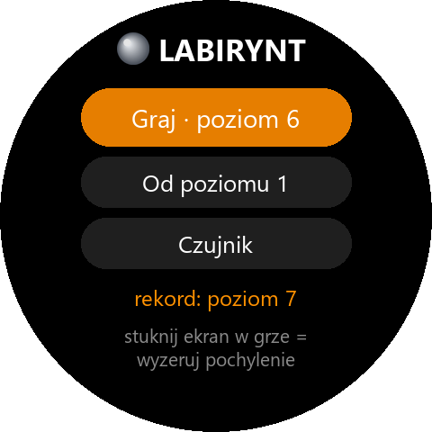

# Labirynt – gra na Amazfit T-Rex 3

Drewniany labirynt z kulką: przechylasz zegarek, kulka toczy się w stronę
pochylenia, a Ty prowadzisz ją do zielonej mety, omijając dziury.

| Gra                                  | Menu                                       |
|--------------------------------------|--------------------------------------------|
|      |      |

## Jak grać

| Co                                   | Działanie                                                   |
|--------------------------------------|-------------------------------------------------------------|
| przechylenie zegarka                 | kulka toczy się w stronę pochylenia                         |
| stuknięcie w ekran                   | **wyzeruj pochylenie** – tak trzymany zegarek to od teraz „poziomo” |
| przyciski góra/dół                   | to samo co stuknięcie                                       |
| dziura                               | wciąga kulkę, która najedzie na brzeg; po wpadnięciu wibracja i powrót na start |
| zielona meta                         | koniec poziomu, po 1,5 s następny                           |
| przycisk wstecz / przesunięcie w prawo | powrót do menu                                            |

Na początku każdego poziomu zegarek przez pół sekundy zapamiętuje, jak go trzymasz –
to jest „poziomo”. Nie trzeba więc trzymać ręki płasko; wystarczy patrzeć na ekran
i trzymać nadgarstek nieruchomo.

Wibracje: dłuższa – kulka wpadła do dziury, podwójna krótka – meta. Uderzenia
w ściany nie wibrują (na zegarku wibracja przychodziła z wyraźnym opóźnieniem).

W trakcie gry ekran nie gaśnie ani po czasie, ani po opuszczeniu nadgarstka
(wraca do normy po wyjściu z gry).

## Poziomy

Każdy poziom ma zawsze ten sam labirynt (numer poziomu jest ziarnem losowania),
więc po wpadnięciu do dziury albo wyjściu z gry wracasz do tego samego układu.
Poziomów jest nieskończenie wiele, a trudność rośnie mniej więcej do 20.:

| Poziom | Plansza  | Dziury |
|--------|----------|--------|
| 1–2    | 7 × 7    | 2–3    |
| 3      | 8 × 8    | 4      |
| 4–5    | 9 × 9    | 5–6    |
| 6–7    | 10 × 10  | 7–8    |
| 8+     | 11 × 11  | 9 i więcej (najwyżej 23) |

Co jeszcze utrudnia grę:

- **Pułapki na zakrętach.** Dziury stoją przede wszystkim na wprost za zakrętem
  drogi – w razie potrzeby gra otwiera tam ścianę. Kulka, która nie wyhamuje przed
  zakrętem, wjeżdża prosto do dziury. Właściwa droga do mety jest zawsze wolna.
- **Dziury wciągają.** Kulka, która najedzie na brzeg dziury, jest ściągana do środka,
  więc trzeba prowadzić ją środkiem korytarza.
- **Kulka coraz bardziej śliska.** Na kolejnych poziomach maleje tarcie, a rośnie
  czułość na pochylenie, maksymalna prędkość, odbicia od ścian i siła wciągania
  dziur (pełna trudność od 20. poziomu).

Meta jest zawsze na polu najdalszym od startu (po korytarzach). Gra zapamiętuje
poziom, na którym skończyłeś, najwyższy ukończony poziom i najlepszy czas każdego
poziomu. Wersja 1.1 ma inne poziomy niż 1.0, więc postęp i rekordy liczą się od nowa.

## Ekran „Czujnik”

Kulka toczy się swobodnie w kole, a u góry widać surowe odczyty akcelerometru
(x, y, z w cm/s²). Jeśli kulka ucieka w złą stronę, przyciski **lewo–prawo**
i **góra–dół** odwracają osie – ustawienie działa też w grze.

Dokumentacja Zepp OS nie mówi, czy leżący zegarek pokazuje z = +980 czy −980, więc
gra rozpoznaje to sama po znaku osi z podczas kalibracji. Odwracanie osi jest zapasem
na wypadek, gdyby osie x/y na zegarku były skierowane inaczej, niż mówi dokumentacja.

## Jak to jest zbudowane

| Plik                                    | Zawartość                                              |
|-----------------------------------------|--------------------------------------------------------|
| [utils/maze.js](utils/maze.js)          | labirynt bez UI: generowanie (wędrówka z cofaniem), meta, pułapki i dziury, wciąganie, ściany jako prostokąty |
| [utils/physics.js](utils/physics.js)    | fizyka kulki: pochylenie → przyspieszenie, tarcie, odbicia od ścian, kalibracja, parametry rosnące z poziomem |
| [utils/device.js](utils/device.js)      | akcelerometr, utrzymanie włączonego ekranu, wibracje   |
| [utils/geometry.js](utils/geometry.js)  | rozmiary plansz i położenie napisów – **generowany**   |
| [utils/store.js](utils/store.js)        | zapis poziomu, rekordów i odwrócenia osi               |
| [page/gt/home](page/gt/home)            | menu                                                   |
| [page/gt/game](page/gt/game)            | gra (25 klatek na sekundę)                              |
| [page/gt/sensor](page/gt/sensor)        | test czujnika                                          |
| [tools/gen_assets.py](tools/gen_assets.py) | rysuje kulki, dziury, mety, ikonę, podglądy i `utils/geometry.js` |

Po zmianie rozmiarów plansz albo wyglądu uruchom generator (Python + Pillow + Node.js):

```bash
python tools/gen_assets.py
```

Testy (wymagają tylko Node.js, nie zegarka):

```bash
node test/maze.test.mjs
```

Sprawdzają m.in. 40 pierwszych poziomów (każde pole osiągalne, dziury poza drogą,
droga do mety wolna od dziur, pułapki na zakrętach, przejścia wolne dla kulki)
i puszczają autopilota, który przechylając wirtualny zegarek przejeżdża poziomy
1–25 prawdziwą fizyką danego poziomu, z wciąganiem przez dziury – bez wjechania
w ścianę i bez wpadnięcia do dziury. Każdy poziom da się więc przejść.

## Budowanie i instalacja

W tym folderze:

```bash
zeus preview
```

Potem w aplikacji Zepp: **Urządzenie → Ogólne → Tryb dewelopera → „+” → Skanuj**.
