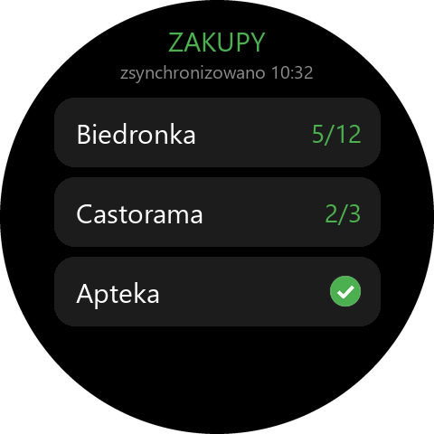
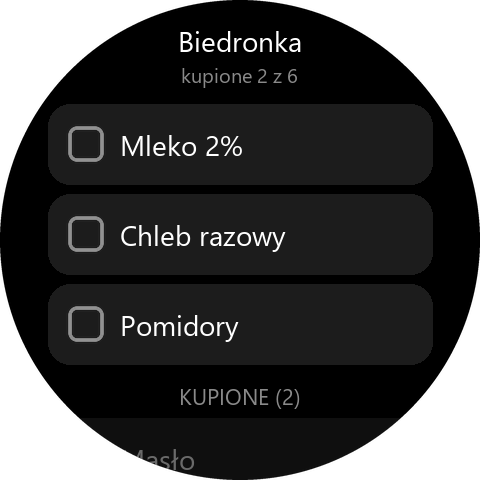

# Zakupy – lista zakupów: telefon + Amazfit T-Rex 3

Listy tworzysz w aplikacji na telefonie, a w sklepie odhaczasz produkty na zegarku.

 

## Jak to działa

```
 phone/ (Flutter)  ──HTTPS──▶  Firebase  ◀──HTTPS──  watch/app-side (Side Service w Zepp)  ◀──BLE──▶  watch/page (zegarek)
 tworzysz listy                Firestore              loguje się, pobiera listy,                     odhaczasz w sklepie
 i produkty                    + Auth                 zapisuje odhaczenia
```

Aplikacja na telefonie nie może rozmawiać z zegarkiem bezpośrednio – Bluetooth z zegarkiem
ma tylko aplikacja Zepp. Dlatego obie strony spotykają się w Firebase (darmowy plan Spark).

| Folder | Co to jest |
|---|---|
| [`phone/`](phone/) | aplikacja Flutter na Androida: logowanie, listy, produkty |
| [`watch/`](watch/) | aplikacja Zepp OS: ekrany zegarka, Side Service, ustawienia w Zepp |
| [`firebase/`](firebase/) | reguły bazy i [instrukcja konfiguracji Firebase](firebase/KONFIGURACJA.md) |
| [`tools/configure.mjs`](tools/configure.mjs) | przepisuje konfigurację z `google-services.json` do obu aplikacji |

### Dane w Firestore

```
lists/{listId}              name, ownerId, members[], memberEmails{uid: e-mail}, createdAt, updatedAt
lists/{listId}/items/{id}   name, checked, createdAt, checkedAt, updatedAt, updatedBy
emails/{e-mail}             uid, email            (książka adresowa do dodawania znajomych)
users/{uid}/friends/{uid}   email, name, addedAt  (znajomi danej osoby)
```

Dostęp do listy ma tylko zalogowany użytkownik wpisany w `members`
([reguły](firebase/firestore.rules)). Wpis w `emails` da się odczytać tylko znając dokładny
adres – nie można przeglądać listy kont.

## Współdzielenie list

1. Każda osoba ma **własne konto** Zakupy – zakłada je w aplikacji na telefonie albo
   w ustawieniach Zakupów w aplikacji Zepp („Nie mam konta – załóż je”).
2. **Znajomi** (ikona osób u góry ekranu list) → **Dodaj znajomego** → e-mail i opcjonalnie
   nazwa, np. „Żona”. Robisz to raz.
3. Na liście: ikona **Udostępnij** (albo menu ⋮ → Udostępnij) → zaznaczasz znajomych → **Zapisz**.
   Lista od razu pojawia się u nich w telefonie i na zegarku.
4. Uprawnienia:
   - **właściciel** listy może dopisywać i usuwać osoby, zmieniać nazwę, usunąć listę (u wszystkich),
   - **pozostali** mogą dopisywać swoich znajomych, edytować produkty i **opuścić listę**
     (telefon: menu ⋮ → Opuść listę; zegarek: Edytuj → Opuść listę).
5. Osoby, które udostępniły Ci listę, pojawiają się w **Znajomi → Proponowani** – jednym
   stuknięciem dodajesz je do znajomych.

## Uruchomienie krok po kroku

1. **Firebase** – według [firebase/KONFIGURACJA.md](firebase/KONFIGURACJA.md); na końcu
   zapisz `google-services.json` w `phone/android/app/`.
2. **Konfiguracja aplikacji** (w folderze `lista-zakupow`):

   ```bash
   node tools/configure.mjs
   ```

3. **Aplikacja na telefon** – zbuduj APK skryptem [`phone/build_apk.cmd`](phone/build_apk.cmd).
   Powstają osobne pliki na architekturę procesora; współczesne telefony potrzebują
   `phone/build/app/outputs/flutter-apk/app-arm64-v8a-release.apk` (ok. 38 MB). Skopiuj go na
   telefon i otwórz albo, z kablem USB i debugowaniem USB:

   ```bash
   adb install -r phone\build\app\outputs\flutter-apk\app-arm64-v8a-release.apk
   ```

   W aplikacji **załóż konto** (e-mail + hasło) i utwórz pierwszą listę.
4. **Aplikacja na zegarek** – w folderze `watch`: `zeus preview` → T-Rex 3 → skan w Zepp.
5. **Logowanie zegarka** – w aplikacji Zepp: Urządzenie → aplikacja **Zakupy** → ustawienia →
   ten sam e-mail i hasło → **Zaloguj**. Hasło służy tylko do zalogowania i jest od razu
   usuwane; w Zepp zostaje token sesji.
6. Otwórz **Zakupy** na zegarku – pojawią się Twoje listy.

## Zegarek

Aplikacja wymaga Zepp OS 4 lub nowszego (API 4.0 – klawiatura systemowa). T-Rex 3 to spełnia.

**Ekran list**
- Listy z licznikiem **zostało/razem** (ptaszek = wszystko kupione); stuknięcie otwiera listę.
- **+ Nowa lista** – nazwa z klawiatury, głosem albo z podpowiedzi (Biedronka, Lidl, …);
  po utworzeniu od razu otwiera się nowa lista.
- **Ustawienia** – patrz niżej.

**Ekran listy (w sklepie)**
- Stuknięcie w produkt odhacza go (krótka wibracja) i przenosi na dół do **KUPIONE**;
  ponowne stuknięcie cofa.
- **+ Dodaj** – produkt z klawiatury (**Wpisz**), głosem (**Podyktuj**) albo z **podpowiedzi**
  (produkty z innych list i wcześniej wpisywane; najczęstsze na górze). Wpisanie produktu
  kupionego wcześniej przywraca go na listę zamiast tworzyć duplikat.
- **Edytuj** – przy produktach pojawia się kosz: stuknięcie usuwa produkt. Dodatkowo
  **Usuń kupione** i **Usuń listę** (z potwierdzeniem). **Gotowe** kończy edycję.
- Ekran świeci 60 s od ostatniego dotknięcia, a **po wygaszeniu i podniesieniu ręki wraca
  ta sama lista** (zamiast tarczy zegarka).

**Ustawienia na zegarku**
- **Nie wygaszaj po opuszczeniu ręki** – na ekranie listy ekran nie gaśnie, gdy opuścisz
  nadgarstek (zgaśnie dopiero po minucie bez dotyku). Domyślnie wyłączone – zużywa więcej baterii.
- **Synchronizuj teraz** i informacja o koncie oraz ostatniej synchronizacji.

**Bez zasięgu też działa** – odhaczanie, dodawanie i usuwanie zapisują się w zegarku
i wysyłają same, gdy wróci połączenie z telefonem (widać „offline · 2 zmiany czekają”).
Stuknięcie w napis u góry wymusza synchronizację.

## Telefon

- Pole na dole listy: wpisz produkt i Enter – pole zostaje aktywne, można dopisywać dalej.
- **Dyktowanie** (mikrofon obok pola) – mówisz produkty z krótką przerwą albo jednym ciągiem
  („mleko, chleb i masło”); telefon po każdej pauzie słucha dalej, a rozpoznane produkty widać
  jako etykiety (krzyżyk usuwa). **Dodaj** wpisuje je na listę – kupione wcześniej wracają,
  powtórek nie ma. Używa rozpoznawania mowy Google w telefonie (internet albo pobrany polski
  pakiet offline).
- **Dodaj z kartki** (ikona skanera obok pola) – wiele produktów naraz:
  - **zdjęcie kartki** albo zdjęcie z galerii, do wyboru:
    - **AI (Gemini)** – przez Firebase AI Logic (model `gemini-3.5-flash`, Gemini Developer API,
      darmowy plan Spark, bez klucza w aplikacji). Najlepsze dla trudnego pisma; wymaga
      internetu, zdjęcie trafia do Google. Gdy się nie uda, aplikacja proponuje rozpoznanie
      tego samego zdjęcia na telefonie.
    - **Na telefonie** – ML Kit Text Recognition, offline (najlepiej wyraźne litery, produkt w linii),
  - **napisz palcem** – ML Kit Digital Ink z modelem polskim (pobierany raz, ok. 20 MB);
    rozpoznaje każde pismo, także łączone,
  - **wklej tekst** – np. skopiowany z Google Lens.

  Potem **ekran sprawdzenia**: aplikacja usuwa numerację i punktory, dzieli po przecinkach,
  poprawia pomyłki na podstawie Twojej historii produktów i słownika ok. 200 typowych zakupów
  („Mieko” → „Mleko”, „maslo” → „Masło”; każdą poprawkę można cofnąć), pomija to, co już jest
  na liście, a kupione wcześniej przywraca. Na listę trafia tylko to, co zaznaczysz.
- Wpisanie produktu, który jest już kupiony, przywraca go na listę (bez duplikatu).
- Przesunięcie produktu w lewo usuwa go (z „Cofnij”); menu ⋮: „Usuń kupione”, „Odznacz wszystko”.
- Zmiany z zegarka widać na telefonie od razu.

## Wspólne konto z aplikacją Powrót

[Powrót](../powrot/README.md) (zapisane miejsca, nawigacja do nich) to osobna aplikacja, ale
korzysta z tego samego projektu Firebase: to samo konto i ci sami znajomi działają w obu.
Logowanie, znajomi i udostępnianie są we wspólnym pakiecie Fluttera [`../wspolne`](../wspolne/),
a [reguły](firebase/firestore.rules) obejmują też kolekcję `places` Powrotu.

## Testy

```bash
cd watch && npm test
```

```bash
cd phone && flutter test
```
