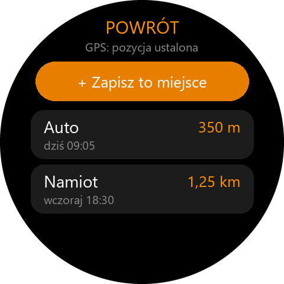
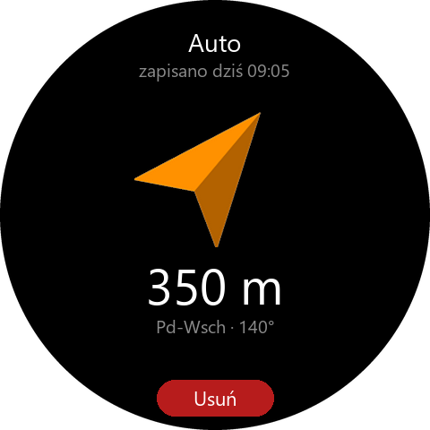

# Powrót – wróć do zapisanego miejsca (Amazfit T-Rex 3 / Active 2)

Zapisujesz miejsce jednym stuknięciem (gdzie stoi auto, namiot, hotel), a potem zegarek
prowadzi Cię z powrotem: **strzałka kompasu** pokazuje kierunek, pod nią **odległość**.
Działa całkowicie na zegarku – bez telefonu i bez internetu (GPS + kompas).

 

| Folder | Co to jest |
|---|---|
| [`watch/`](watch/) | aplikacja Zepp OS: zapisywanie miejsc i nawigacja strzałką |
| [`phone/`](phone/) | aplikacja Flutter na Androida: miejsca w Google Maps, trasa GPX na zegarek, udostępnianie |
| [`tools/configure.mjs`](tools/configure.mjs) | przepisuje konfigurację z `google-services.json` do obu aplikacji |

Telefon jest opcjonalny – zegarek działa sam.

## Zegarek

- **+ Zapisz to miejsce** → zegarek czeka na sygnał GPS (pod gołym niebem zwykle kilka–kilkanaście
  sekund) → wybierasz nazwę: **Auto, Rower, Namiot, Hotel, Dom**, **Wpisz nazwę** (klawiatura
  albo dyktowanie) lub **Bez nazwy** („Punkt 1”, „Punkt 2”…).
  Zapisanie miejsca o tej samej nazwie (np. kolejne „Auto”) zastępuje stare.
- Lista miejsc pokazuje **odległość na żywo**. Stuknięcie otwiera nawigację.
- **Nawigacja**: strzałka obraca się razem z zegarkiem i zawsze wskazuje cel; pod nią odległość
  oraz kierunek (np. „Pd-Wsch · 140°”). W odległości ok. 15 m: **„Na miejscu!”** i wibracja.
- Ekran świeci 60 s od ostatniego dotknięcia, a po wygaszeniu i podniesieniu ręki wraca
  ta sama nawigacja (nie tarcza zegarka).
- **Usuń** na ekranie nawigacji kasuje miejsce (z potwierdzeniem).

Strzałka wskazuje cel **w linii prostej** – nie prowadzi ścieżkami. Do prowadzenia po szlaku
służy trasa GPX z telefonu (niżej).

### Kompas

Gdy kompas wymaga kalibracji, strzałka znika i pojawia się podpowiedź – zatocz nadgarstkiem
kilka razy ósemkę w powietrzu. Odległość i kierunek (strony świata) działają także bez kompasu.

### Logowanie (opcjonalnie)

W aplikacji Zepp: **Urządzenie → Powrót → ustawienia** → zaloguj się tym samym kontem co
w aplikacjach Powrót i Zakupy na telefonie. Wtedy zapisane miejsca trafiają do telefonu,
a miejsca udostępnione Ci przez znajomych pojawiają się na zegarku z dopiskiem „od: …”
(„Usuń u mnie” chowa je tylko u Ciebie).

Bez logowania wszystko działa lokalnie, a zmiany czekają w kolejce i wyślą się po zalogowaniu.
Miejsca z wersji 1.0 przenoszą się automatycznie.

## Telefon

Lista miejsc z zegarka (i udostępnionych przez znajomych) z odległością od Ciebie. Przy miejscu:

- **Kompas – na azymut** (ikona kompasu przy miejscu) – strzałka do celu jak na zegarku, do marszu
  w terenie bez dróg (niżej),
- **Nawiguj pieszo / autem** – Google Maps z trasą do miejsca (np. do zaparkowanego auta),
- **Trasa na zegarek (plik GPX)** – trasa od Twojej pozycji do miejsca. W menu udostępniania
  wybierz **Zepp** → zapisz trasę → **Wyślij do zegarka**; na T-Rexie: **Trening → np. Spacer →
  Nawigacja → Moje trasy**. Mapa zegarka działa potem bez telefonu,
- **Udostępnij znajomym** – u nich miejsce pojawia się w telefonie i w Powrocie na zegarku,
- **Wyślij link do lokalizacji**, **Zmień nazwę**, **Usuń** (cudze: „Usuń u mnie”).

### Kompas na azymut

Duża strzałka obraca się razem z telefonem i zawsze wskazuje cel **z miejsca, w którym jesteś** –
można obchodzić przeszkody (bagno, gęstwinę, ogrodzenie) i strzałka sama poprawia kierunek.
Pod nią odległość, azymut do celu (np. „Pn-Wsch · 47°”), dokładność GPS i użyta deklinacja.

- Trzymaj telefon **płasko**, górą przed siebie. Ekran nie gaśnie, dopóki jest otwarty kompas.
- W promieniu ok. **15 m**: „Na miejscu!” i wibracja; ponowny alarm dopiero po oddaleniu się na 30 m
  (drgania GPS przy granicy nie wibrują bez końca) – tak samo jak na zegarku.
- Gdy Android zgłasza słabą dokładność kompasu, pojawia się podpowiedź kalibracji (ósemka w powietrzu,
  z dala od metalu i magnesów w etui). Bez magnetometru strzałka jest szara, a ekran podaje azymut
  do sprawdzenia zwykłym kompasem lub zegarkiem. Brak GPS, wyłączona lokalizacja lub brak zgody –
  komunikat z przyciskiem (Włącz / Zezwól / Ustawienia / Ponów).
- **Orientacja ekranu**: kompas ustawia ekran pionowo; `flutter_compass` i tak przelicza kierunek
  względem obrotu ekranu (`Display.getRotation`).
- **Deklinacja**: `flutter_compass` (czujnik `TYPE_ROTATION_VECTOR`) daje kierunek do północy
  **magnetycznej**, a azymut z GPS jest do geograficznej. W Polsce różnica to ok. 5–8° na wschód
  (≈100 m odchyłki na 1 km), więc ją dodajemy. Zamiast pełnego modelu WMM (kilkaset
  współczynników) jest siatka z kalkulatora NOAA (WMM2025, epoka 2027 + zmiana roczna) dla Polski
  i okolic (szer. 45–58,5°, dł. 9–27,5°) – ta sama co w aplikacji Szczyty. Poza tym obszarem
  poprawki nie ma, a ekran pisze „kierunek magnetyczny”.

Logika (odległość, azymut, kąt strzałki, wygładzanie, strony świata, „na miejscu”, deklinacja)
jest w czystym Darcie w [`phone/lib/geo.dart`](phone/lib/geo.dart), testy w
[`phone/test/geo_test.dart`](phone/test/geo_test.dart); ekran: `phone/lib/compass_screen.dart`.

Konto i znajomi są wspólne z aplikacją [Zakupy](../lista-zakupow/README.md) (pakiet
[`../wspolne`](../wspolne/)).

### Dane w Firestore

```
places/{id}   name, lat, lon, savedAt, ownerId, members[], memberEmails{uid: e-mail}, createdAt, updatedAt, source
```

Te same zasady udostępniania co listy zakupów; reguły są w
[`../lista-zakupow/firebase/firestore.rules`](../lista-zakupow/firebase/firestore.rules).

## Uruchomienie krok po kroku

1. **Reguły** – opublikuj aktualne `lista-zakupow/firebase/firestore.rules` (z blokiem `places`)
   w konsoli Firebase → Firestore → Reguły.
2. **Aplikacja Android w Firebase** – w tym samym projekcie co Zakupy: Ustawienia projektu →
   Twoje aplikacje → **Dodaj aplikację → Android**, pakiet **`pl.grekot.powrot`**. Pobierz
   `google-services.json` i zapisz w `phone/android/app/`.
3. **Konfiguracja** (w folderze `powrot`):

   ```bash
   node tools/configure.mjs
   ```

4. **Telefon** – zbuduj APK skryptem [`phone/build_apk.cmd`](phone/build_apk.cmd) i zainstaluj
   `phone/build/app/outputs/flutter-apk/app-arm64-v8a-release.apk`. Zaloguj się kontem z Zakupów.
5. **Zegarek** – w folderze `watch`: `zeus preview` → wybierz zegarek → skan w aplikacji Zepp
   (Urządzenie → Ogólne → Tryb dewelopera → „+” → Skanuj). Potem zaloguj się w ustawieniach
   Powrotu w Zepp.

## Technicznie (zegarek)

| Plik | Co robi |
|---|---|
| `watch/utils/geo.js` | odległość (haversine), kierunek do celu, kąt strzałki, wygładzanie kompasu, formaty |
| `watch/utils/places.js` | lista miejsc, kolejka zmian do wysłania, scalanie z serwerem |
| `watch/utils/store.js` | zapis w pamięci zegarka |
| `watch/utils/sensors.js` | GPS (`Geolocation`) i kompas (`Compass`) z `@zos/sensor` |
| `watch/utils/firestore.js` | zapytania REST do Firestore (Side Service) |
| `watch/page/gt/home` | lista miejsc z odległością |
| `watch/page/gt/save` | zapisywanie miejsca |
| `watch/page/gt/navigate` | strzałka, odległość, kierunek |

Wymaga Zepp OS 4 (API 4.0 – klawiatura); uprawnienia: lokalizacja, kompas, pamięć.
Strefa „na miejscu” to 15 m (`ARRIVED_M` w `watch/utils/geo.js`) – GPS w zegarku ma dokładność
kilku–kilkunastu metrów.

Projekt zegarka jest w osobnym folderze `watch`, bo zeus pakuje do instalki cały folder
projektu (`.ip-package`) – z Flutterem obok instalka miała 15 MB zamiast ok. 190 KB.

## Testy

```bash
cd watch && npm test
```

```bash
cd phone && flutter test
```
