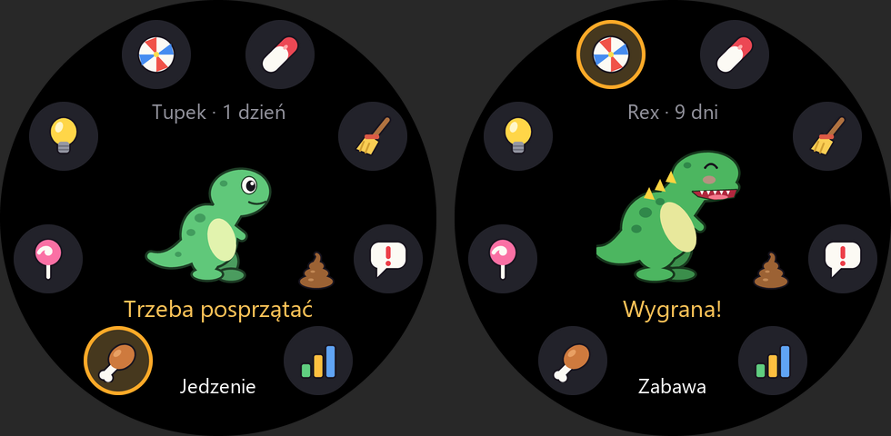
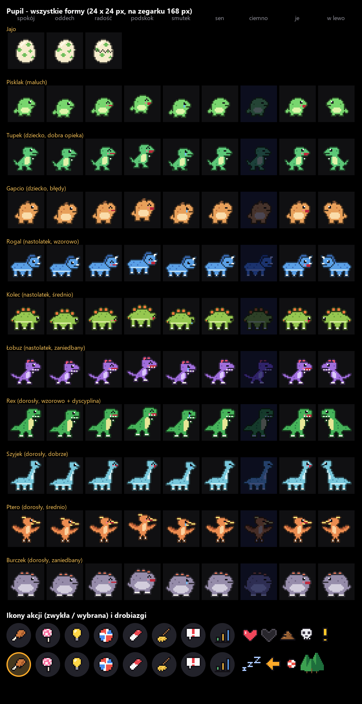

# Pupil – tamagotchi z dinozaurem

Klasyczne tamagotchi na Amazfit T-Rex 3: z jajka wykluwa się dinozaur (gładka, kreskówkowa grafika),
rośnie przez kilka etapów i zmienia formę zależnie od tego, jak o niego dbasz.
Tempo jest luźne – wystarczy zajrzeć 2–3 razy dziennie. Czas płynie także przy
zamkniętej aplikacji.



## Jak grać

Dinozaur stoi na środku tarczy, dookoła jest pierścień ikon akcji. Stuknij ikonę albo
wybierz ją przyciskami **góra/dół** i zatwierdź przyciskiem **wyboru** (`KEY_SELECT`; przycisk skrótu zostaje dla systemu).

| Ikona       | Co robi |
|-------------|---------|
| Jedzenie    | +1 serce głodu, +1 g. Najedzony odmawia. Przy słabej dyscyplinie nastolatek i dorosły czasem kręcą nosem |
| Przekąska   | +1 serce humoru, +2 g (chory nie chce) |
| Światło     | od 20:00 robi się senny – zgaś światło; o 21:30 zasypia sam, o 7:30 wstaje i światło zapala się samo. Zgaszonego w nocy nie da się przypadkiem zapalić. Pora dnia z systemowego zegara (`Time`) |
| Zabawa      | minigry (niżej); wygrana +1 humoru, każda gra −1 g |
| Lekarstwo   | leczy chorobę (1–2 dawki) |
| Sprzątanie  | usuwa kupy |
| Zgań        | gdy marudzi bez powodu: +1 dyscypliny; zganiony bez powodu się smuci |
| Statystyki  | serca, waga, wiek, pokolenie, błędy opieki → zmiana imienia, kolekcja form |

Stuknięcie w dinozaura – krótka reakcja. Wykrzyknik = czegoś potrzebuje, czaszka = chory,
kupy leżą obok niego.

### Upływ czasu (na jawie; w nocy nic nie spada)

| Etap      | Trwa         | Głód −1 co | Humor −1 co | Kupa co |
|-----------|--------------|-----------|-------------|---------|
| jajo      | 3 min        | –         | –           | –       |
| maluch    | 2 h          | ~1 h      | ~1 h        | ~1 h    |
| dziecko   | 1 dzień      | ~3 h      | ~3 h        | ~3,3 h  |
| nastolatek| 3 dni        | ~4 h      | ~3,5 h      | ~4,3 h  |
| dorosły   | do starości  | ~5 h      | ~4,5 h      | ~5 h    |

Odstępy mają rozrzut ±25%. Dziecko i starsze czasem marudzą bez powodu (ok. raz dziennie, przez 4 h).

**Błąd opieki** liczy się, gdy głód albo humor są na zerze dłużej niż 3 h czuwania
(potem co 12 h), choroba trwa ponad 6 h, śpi przy zapalonym świetle ponad 1 h (raz na noc)
albo marudzenie przeszło bez zganienia. Kupa leżąca ponad 6 h grozi chorobą, nadwaga też.

**Ewolucja** (według błędów w kończącym się etapie):



Przy nowym jaju wybierasz jedno z trzech jajek (linię) i imię z listy (albo bez imienia –
wtedy na górze ekranu jest nazwa formy). Imię można zmienić w statystykach.

| Jajo          | maluch  | dziecko (0 błędów) | nastolatek (≤2) | dorosły: wzorowo (≤1 i dyscyplina ≥2) | dorosły: dobrze (≤4) |
|---------------|---------|--------------------|-----------------|---------------------------------------|----------------------|
| zielone – drapieżniki | Pisklak | Tupek | Łobuz | Rex | Allo |
| niebieskie – roślinożercy | Kropek | Rożek | Rogal | Szyjek | Kolec |
| pomarańczowe – latające | Piórko | Pterek | Lotek | Ptero | Mewa |

Zaniedbane formy są wspólne: Gapcio (maluch z błędami), Mruk (dziecko z 3+ błędami;
z Gapcia przy ≤1 błędzie wraca do linii), Burczek (nastolatek z 5+ błędami albo Mruk z 2+; Mruk przy ≤1 błędzie dorasta do formy „dobrze”).
Razem 18 form w kolekcji.

**Odejście jest łagodne**: ze starości (13 dni od wyklucia + do 8 dni premii, każde
2 błędy przez całe życie zabierają dzień) dinozaur zostawia jajo; po długim
zaniedbaniu (24 h czuwania w głodzie, smutku albo chorobie) ucieka do lasu. Wtedy
stuknij ekran – wybierasz nowe jajo i imię, kolekcja zdobytych form zostaje.

### Minigry

- **Rzut piłką** – machnij nadgarstkiem, siła machnięcia = odległość. Dinozaur łapie,
  jeśli piłka spadnie do 12 m od niego. 2 złapane z 3 = wygrana.
- **Kołysanie do snu** – delikatnie bujaj ręką, aż pasek snu się zapełni (8 s); za mocno
  albo szarpnięcie budzi (3 pobudki albo 40 s = przegrana).
- **Balans na kłodzie** – przechylaj zegarek w bok, żeby dinozaur nie spadł przez 15 s
  (na początku 0,6 s kalibracji – trzymaj poziomo).
- **Lewo czy prawo?** – bez ruchu: zgadnij, w którą stronę spojrzy (strzałki albo
  przyciski góra = lewo, dół = prawo). 3 trafienia z 5 = wygrana.

Od wersji 1.1 jest 22 gier w przewijanym menu (logika w `utils/moves.js` i `utils/walks.js`):

| Gra | Czujnik | Jak wygrać |
|-----|---------|-----------|
| Powtórz ruch | akcelerometr | powtórz przechyłami sekwencję strzałek aż do 6 ruchów (2 pomyłki dozwolone) |
| Łapanie owoców | akcelerometr | przechylaj w bok, złap 10 owoców w 30 s, omijaj kamienie (3 życia) |
| Labirynt jajka | akcelerometr | dotocz jajko do gniazda w 40 s (3 plansze) |
| Celowanie | akcelerometr | celuj przechyłem, stuknij = rzut; 3 trafienia z 5 |
| Refleks | akcelerometr | machnij, gdy kółko zzielenieje; średnio poniżej 0,65 s, bez falstartów |
| Wędkowanie | akcelerometr | poderwij rękę w 1,3 s po wibracji; 2 ryby z 3 |
| Skoki | akcelerometr | podrzut nadgarstka (albo stuknięcie) = skok; wytrzymaj 25 s |
| Potrząśnij drzewem | akcelerometr | 12 owoców w 15 s; za mocno 2 razy = pszczoły |
| Wykopywanie kości | akcelerometr | 15 ruchów łopatą w 25 s |
| Balon | akcelerometr | pompuj ruchem ręki, puść w zielonym przedziale |
| Medytacja | akcelerometr | 20 s zupełnego bezruchu (w ciągu minuty) |
| Wyścig | akcelerometr | biegnij w miejscu szybciej niż rywal przez 15 s |
| Rozgrzewka | akcelerometr | 8 krążeń ramion, 8 wymachów, 5 skłonów |
| Szukanie jedzenia | kompas | „ciepło – gorąco” i wibracje; 3 kierunki w 90 s |
| Wspinaczka | barometr | Start, potem 3 m wyżej w ciągu 6 h (zadanie spacerowe) |
| Nurkowanie | barometr | 3 razy szybko opuść i podnieś rękę (eksperyment – pokazuje zmianę wysokości) |
| Wyprawa | GPS + kompas | dojdź do skarbu 200–500 m stąd w ciągu 3 h (zadanie spacerowe) |
| Znaczenie terenu | GPS | oznacz 3 miejsca co najmniej 100 m od siebie w ciągu doby |

Zadania spacerowe zapisują się w stanie (`s.walks`) – aplikację można zamknąć, a po
powrocie do gry zegarek sprawdza postęp. Nagroda: humor +2 (zwykła gra +1).

Strony gier ruchowych trzymają ekran włączony (i przywracają ustawienia przy wyjściu).

### Przypomnienie (niesprawdzone na zegarku)

Przy wyjściu z aplikacji Pupil przewija czas do przodu (do 20 h), znajduje pierwszą
chwilę, kiedy będzie czegoś potrzebował (głód lub humor na zerze, kupa, choroba,
marudzenie, zapalone światło w nocy), i ustawia systemowy alarm `@zos/alarm`
(uprawnienie `device:os.alarm`), który o tej porze otworzy aplikację. Ekran główny
rozpoznaje to po zapisanej godzinie, wibruje i pokazuje „Pupil cię woła!”. Przypomnienia
padają tylko między 7:45 a 22:00; jeśli już czegoś potrzebuje, kolejne za 2 h.

## Jak to działa

- `utils/pet.js` – cały stan i logika (czysty JS). Stan z czasem `t` leży w pliku
  `pupil_state.json` w `/data` aplikacji (+ kopia `.bak`; `utils/files.js`, `@zos/fs`); po otwarciu `advance()` przewija czas minuta po minucie, z losowością
  z generatora zapisanego w stanie – wynik jest deterministyczny, także przy przewijaniu
  kawałkami.
- `utils/games.js` – logika minigier (detektor machnięcia, kołysania, fizyka balansu).
- `utils/store.js` – zapis/odczyt (nie LocalStorage: na zegarku zapis z jednej strony
  potrafił nadpisać świeży stan starą kopią z innej); każda strona przewija czas i zapisuje, strona główna
  co sekundę sprawdza, czy stan się zmienił.
- `utils/reminder.js` – alarm z przypomnieniem (funkcja `nextReminder` w `pet.js`).
- `tools/smoke.mjs` – smoke test prawdziwych bundli zeusa w Node `vm` (atrapy `@zos/*`,
  sztuczny zegar); bundle przechwytuje `tools/capture-hook.cjs` (opis w nagłówku smoke.mjs).
- `tools/gen_assets.py` – grafika: postacie w `tools/forms.py` z prostych kształtów
  (elipsy, wielokąty, zwężające się „rurki”, `tools/draw.py`) rysowanych w 8× powiększeniu
  z obrysem jak naklejka; miny i klatki (oddech, radość, smutek, sen, jedzenie, lustro)
  dorysowuje generator. Ikony w `tools/icons.py`. Powstają też `utils/geometry.js`,
  arkusz `docs/arkusz.png` i makieta `docs/podglad.png`.

```bash
npm install
npm test                     # testy logiki w Node
python tools/gen_assets.py   # po zmianie grafiki
zeus preview                 # instalacja na zegarku
```

## Niesprawdzone na zegarku

- progi ruchu w minigrach (`THROW`, `ROCK`, `BALANCE` w `utils/games.js`) to szacunki;
- który fizyczny przycisk T-Rex 3 daje `KEY_SELECT` (zatwierdzanie akcji przyciskiem);
- kierunek przechyłu w balansie przyjęty jak w Labiryncie (tam sprawdzony);
- przypomnienie przez `@zos/alarm` (czy alarm otwiera aplikację i włącza ekran).
