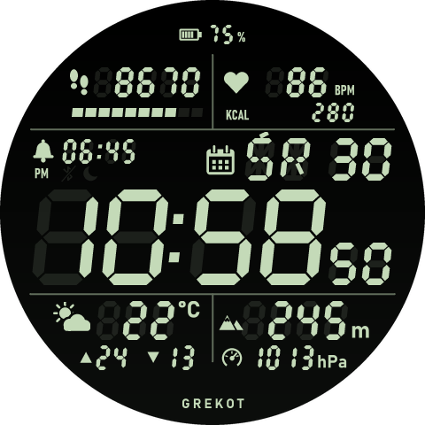

# Retro LCD Negatyw

Wariant tarczy [Retro LCD](../retro-lcd/README.md) w palecie `negative`, jako osobna tarcza (appId 1087159).

Folder jest **generowany** - nie edytuj go. Zmiany rób w `retro-lcd`, potem z tamtego folderu:

```bash
python tools/make_variant.py negative 1087159 "Retro LCD Negatyw" ../retro-lcd-negatyw
```



Instalacja: `zeus preview` w tym folderze.
