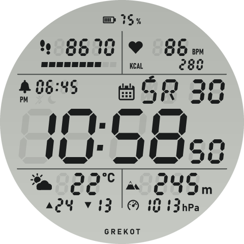
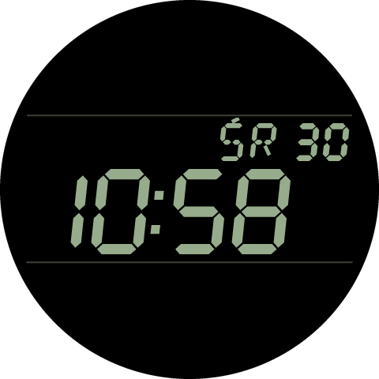
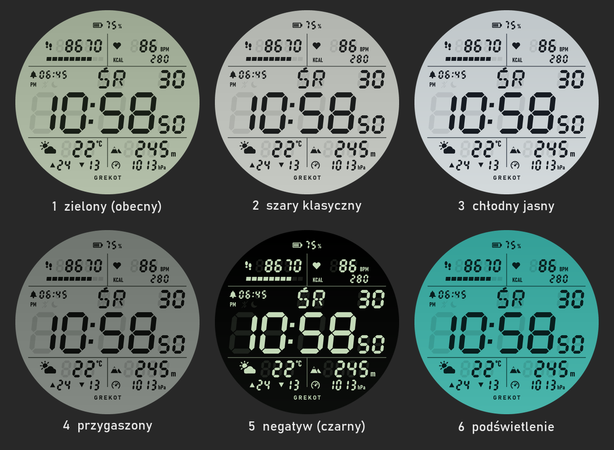

# Retro LCD – tarcza na Amazfit T-Rex 3

Tarcza w stylu klasycznego zegarka cyfrowego z lat 80.: cały ekran to jeden zielonkawy
LCD z pochylonymi cyframi 7-segmentowymi i „duchami” niezapalonych segmentów.
Nadrukowane linie dzielą go na trzy strefy: duży czas w środku, a nad nim i pod nim
po dwa pola z danymi.

| Tryb normalny | Tryb AOD (wygaszony ekran) |
|---------------|----------------------------|
|  |  |

## Co pokazuje

| Miejsce               | Dane                                                        |
|-----------------------|-------------------------------------------------------------|
| środkowa strefa       | godzina, minuty, sekundy, PM (w trybie 12 h), ikona kalendarza, dzień tygodnia po polsku (PN WT ŚR CZ PT SB ND) i dzień miesiąca |
| wskaźniki             | dzwonek + godzina najbliższego budzika (tylko gdy budzik jest włączony), przekreślone BT – brak połączenia z telefonem, księżyc – nie przeszkadzać |
| lewe górne pole       | kroki + pasek postępu do dziennego celu (10 segmentów)      |
| prawe górne pole      | tętno (BPM) + kalorie (KCAL)                                 |
| lewe dolne pole       | ikona pogody, temperatura, max (▲) i min (▼) na dziś        |
| prawe dolne pole      | wysokość n.p.m. (m) + ciśnienie atmosferyczne (ikona barometru, hPa) |
| góra                  | bateria: ikona + procent                                     |

Blade „duchy” cyfr i ikon (np. dzwonka) są zawsze widoczne – to niezapalone segmenty,
jak na prawdziwym LCD. Zapalony dzwonek oznacza włączony budzik.

Ikona pogody zmienia się według aktualnej pogody z telefonu (29 ikon: słońce, chmury,
deszcz, śnieg, burza, mgła…; w podglądzie jest przykładowe „słońce z chmurą”).

Stuknięcie w pole kroków, tętna, pogody lub wysokości otwiera odpowiednią aplikację systemową.
Wysokość i ciśnienie pokazują „--”, dopóki zegarek nie zrobi pomiaru barometrem.
Wszystkie wartości odświeża system (widżety `IMG_TIME`, `TEXT_IMG` z `data_type` itd.),
więc tarcza nie ma własnych timerów i nie zużywa dodatkowo baterii.

W trybie AOD zostaje tylko czas, dzień tygodnia i data w jasnych segmentach na czarnym
tle (bez sekund) – zgodnie z zaleceniem Zepp, by AOD świecił < 10% pikseli.

## Grafika

Cała grafika (tło, cyfry, ikony pogody, podglądy) powstaje ze skryptu
[tools/gen_assets.py](tools/gen_assets.py) (Python + Pillow, font Bahnschrift z Windows).
Skrypt zapisuje też [watchface/layout.js](watchface/layout.js) ze współrzędnymi, bo
„duchy” segmentów w tle muszą trafiać co do piksela w cyfry rysowane przez widżety.
Po zmianie kolorów albo układu:

```bash
python tools/gen_assets.py
```

### Palety kolorów

Kolory LCD to jedna z palet w `PALETTES` (domyślnie `grey`). Inną paletę podaje się
jako argument, np. `python tools/gen_assets.py negative`. Porównanie wszystkich:



Żeby mieć na zegarku kilka wersji naraz, [tools/make_variant.py](tools/make_variant.py)
tworzy obok kopię tarczy w innej palecie z własnym appId. Tak powstał
[retro-lcd-negatyw](../retro-lcd-negatyw/README.md):

```bash
python tools/make_variant.py negative 1087159 "Retro LCD Negatyw" ../retro-lcd-negatyw
```

Po każdej zmianie w tym projekcie uruchom to polecenie ponownie, żeby wariant był aktualny.

## Budowanie i instalacja

W tym folderze:

```bash
zeus preview
```

Wybierz **Amazfit T-Rex 3**, a potem w aplikacji Zepp: **Urządzenie → Ogólne → Tryb
dewelopera → „+” → Skanuj**. Tarcza pojawi się na liście tarcz w zegarku (przytrzymaj
palec na obecnej tarczy i przewiń).
