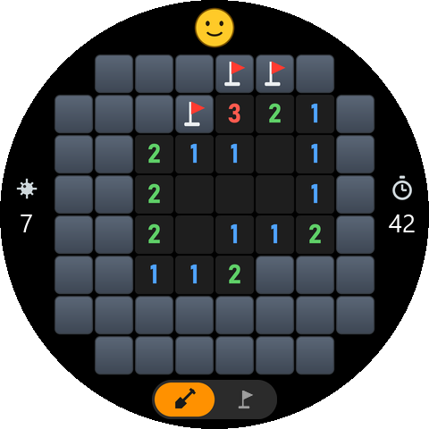
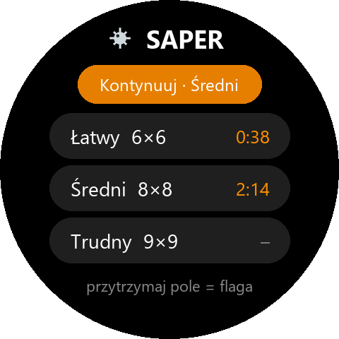

# Saper – gra na Amazfit T-Rex 3

Klasyczny Saper na okrągłym ekranie zegarka. Plansza zajmuje środek ekranu,
a jej rogi, które wystawałyby poza okrąg, są wycięte z gry.

| Gra                                  | Menu                                       |
|--------------------------------------|--------------------------------------------|
|      |      |

## Poziomy

| Poziom  | Plansza | Pól w grze | Miny | Pole   |
|---------|---------|-----------:|-----:|--------|
| Łatwy   | 6 × 6   | 32         | 5    | 60 px  |
| Średni  | 8 × 8   | 60         | 10   | 45 px  |
| Trudny  | 9 × 9   | 77         | 15   | 40 px  |

Pierwszy ruch nigdy nie trafia na minę: miny są losowane dopiero po pierwszym
stuknięciu, z dala od niego, więc od razu odsłania się kawałek planszy.

## Sterowanie

| Gest                                   | Działanie                                         |
|----------------------------------------|---------------------------------------------------|
| stuknięcie w zakryte pole              | odkrycie pola (w trybie flagi: flaga)             |
| przytrzymanie pola (0,4 s)             | postawienie / zdjęcie flagi (krótka wibracja)     |
| stuknięcie w cyfrę                     | gdy wokół stoi tyle flag, ile pokazuje cyfra – odkrycie reszty sąsiadów |
| przełącznik na dole (łopata / flaga)   | co robi zwykłe stuknięcie                         |
| przyciski góra/dół zegarka             | to samo co przełącznik                            |
| buźka u góry                           | nowa gra (w trakcie partii trzeba stuknąć dwa razy) |
| przycisk ↻ na dole po końcu partii      | nowa gra                                          |
| przycisk wstecz / przesunięcie w prawo | powrót do menu                                    |

Po lewej jest licznik min (miny minus flagi), po prawej czas w sekundach.
Flaga chroni pole przed przypadkowym odkryciem w trybie łopaty.

Przerwana partia jest zapisywana w zegarku – w menu pojawia się wtedy
**Kontynuuj**, a czas liczy się dalej od chwili powrotu. W menu przy każdym
poziomie widać rekord (najlepszy czas wygranej).

## Jak to jest zbudowane

| Plik                                    | Zawartość                                              |
|-----------------------------------------|--------------------------------------------------------|
| [utils/mines.js](utils/mines.js)        | logika gry bez UI: losowanie min, odkrywanie z rozlaniem zer, flagi, akord, wygrana/przegrana, zapis |
| [utils/geometry.js](utils/geometry.js)  | poziomy, maski wyciętych rogów i położenie elementów ekranu – **generowany** |
| [utils/store.js](utils/store.js)        | zapis przerwanej partii i rekordów w pamięci zegarka   |
| [page/gt/home](page/gt/home)            | menu                                                   |
| [page/gt/game](page/gt/game)            | plansza                                                |
| [tools/gen_assets.py](tools/gen_assets.py) | rysuje wszystkie kafelki, ikony, przełącznik, ikonę aplikacji, podglądy i `utils/geometry.js` |

Każde pole to jeden obrazek – kafelki (zakryte, flaga, 0–8, mina, trafiona mina,
błędna flaga) są narysowane osobno dla każdego rozmiaru pola. Po zmianie poziomów
albo wyglądu uruchom generator (Python + Pillow, fonty z Windows):

```bash
python tools/gen_assets.py
```

Testy logiki (wymagają tylko Node.js, nie zegarka):

```bash
node test/mines.test.mjs
```

Testy grają też automatem z prostymi regułami (flaguj oczywiste miny, odkrywaj
oczywiste pola, inaczej zgaduj): wygrywa ok. 72% partii na łatwym, 58% na średnim
i 33% na trudnym.

## Budowanie i instalacja

W tym folderze:

```bash
zeus preview
```

Potem w aplikacji Zepp: **Urządzenie → Ogólne → Tryb dewelopera → „+” → Skanuj**.
