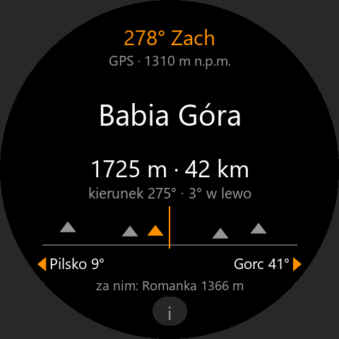
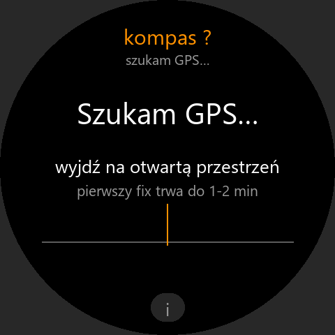
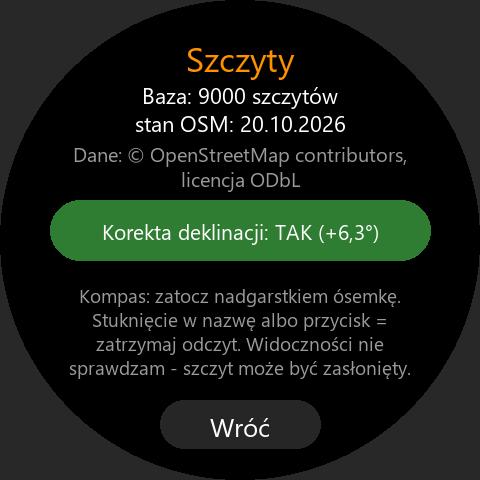

# Szczyty – co to za szczyt?

Stoisz na szlaku, kierujesz zegarek **godziną 12** na górę na horyzoncie, a ekran mówi:
**Babia Góra · 1725 m · 42 km**, kierunek, sąsiednie szczyty po bokach i co jest „za nim”.
Działa całkowicie **offline**: GPS + kompas + barometr + wbudowana baza szczytów z OpenStreetMap.

| Wynik                          | Czekanie na GPS                       | Informacje                              |
|--------------------------------|---------------------------------------|-----------------------------------------|
|    |           |     |

## Obsługa

| Gest                                   | Działanie                                                    |
|----------------------------------------|--------------------------------------------------------------|
| trzymaj zegarek poziomo, 12:00 na górę | nazwa, wysokość, odległość, kierunek, ile stopni w lewo/prawo |
| stuknięcie w nazwę / przycisk góra-dół | **STOP** – zatrzymuje odczyt (opuść rękę i przeczytaj spokojnie), drugie stuknięcie wznawia |
| „i” na dole                            | informacje: baza, atrybucja OSM, korekta deklinacji          |

Na ekranie:

- u góry kierunek 12:00 („278° Zach”), pod nim GPS / ostatnia pozycja i wysokość z barometru,
- duża **nazwa**, „**1725 m · 42 km**”, „kierunek 275° · 3° w lewo”,
- **pasek horyzontu** ±30°: trójkąty to szczyty (wyżej = wyżej w oczach), pomarańczowy to wybrany,
- **‹ Pilsko 9°** po lewej i **Gorc 41° ›** po prawej – najbliższe wyraźne szczyty obok,
- „**za nim:** …” – dalszy szczyt prawie w tym samym kierunku.

Kompas wymaga kalibracji – gdy zegarek pokazuje „Kalibracja kompasu”, zatocz nadgarstkiem
kilka razy **ósemkę** w różnych kierunkach. Zegarek trzymaj poziomo, z dala od metalu.

Ekran świeci minutę, a po wygaszeniu wystarczy podnieść rękę – wraca ta sama strona
(`setWakeUpRelaunch`). Ostatnia pozycja zostaje w pamięci, więc zanim GPS złapie fix
(pierwszy może trwać 1–2 min), aplikacja liczy z poprzedniej („pozycja: dziś 14:05”).

## Jak wybiera szczyt

1. Z pozycji GPS czyta z bazy tylko kafle w promieniu ~106 km.
2. Dla każdego szczytu w zasięgu 100 km liczy odległość, kierunek i **kąt wzniesienia** nad
   oko – z wysokością z barometru i **krzywizną Ziemi** z refrakcją (k = 0,13: na 100 km
   szczyt „zapada się” o ok. 680 m). Szczyty za widnokręgiem odpadają. W każdym wycinku 5° zostaje
   6 najbardziej widocznych (najwyżej 432 razem), żeby wysokie Tatry nie wypchnęły z listy
   niższych, bliskich szczytów w innych kierunkach.
3. Przy każdym odczycie kompasu (5 razy na sekundę) w stożku ±15° wygrywa szczyt z najmniejszym
   `odchylenie − 1,5 × kąt wzniesienia − ranga/64`: przy podobnym kącie wygrywa wyższy w oczach
   (czyli wyższy albo bliższy), a znany szczyt dostaje kilka stopni przewagi.
4. Szczyt w tym samym kierunku (±1,2°) za bliższym, który w oczach jest wyżej, oznaczany jest
   jako prawdopodobnie zasłonięty („może zasłonięty”) i dostaje karę – zwykle trafia do „za nim”.

**Uczciwie:** bez modelu terenu aplikacja **nie wie, co naprawdę widać**. Zasłonięcie liczy
tylko szczyt za szczytem z bazy, nie grzbiety, przełęcze, las ani budynki. Pokazuje
„najlepszy szczyt w tym kierunku”, a nie gwarancję, że właśnie on jest na horyzoncie.
Kompas zegarka myli się zwykle o kilka stopni, więc przy gęstych grzbietach (Tatry) warto
spojrzeć na „kierunek” i sąsiadów po bokach.

## Kompas i deklinacja

Dokumentacja Zepp OS mówi tylko, że `getDirectionAngle()` to kąt „względem północy” – nie
mówi, czy geograficznej, czy magnetycznej. Czujnik magnetyczny mierzy północ magnetyczną,
a w Polsce różnica wynosi **+5 do +8°** (wschodnia), więc aplikacja domyślnie **dodaje
deklinację** z modelu WMM2025 (siatka z kalkulatora NOAA dla 48–55,5° N i 12–24,5° E, ze zmianą
roczną; dokładność ~0,4°). Na stronie „i” korektę można wyłączyć.

**Do sprawdzenia na zegarku:** skieruj 12:00 na znany szczyt albo wzdłuż prostego odcinka
drogi z mapy. Jeśli z korektą wynik jest stale ~6° obok, a bez niej trafia – system już
uwzględnia deklinację i korektę trzeba wyłączyć (wtedy zmienię domyślne ustawienie).

Odczyt jest wygładzany (25% nowej wartości co 200 ms, przy szybkim obrocie 60%), a krótkie
zaniki kompasu (do 3 s) nie gaszą wyniku.

## Baza szczytów

Dane: **© OpenStreetMap contributors**, licencja [ODbL 1.0](https://www.openstreetmap.org/copyright).
Atrybucja jest też na ekranie informacji w aplikacji.

Obszar: Polska i wszystko do **100 km od granicy** – cała słowacka strona Tatr, Mała i Wielka
Fatra, Niżne Tatry, czeskie Karkonosze, Góry Izerskie, Jesioniki i Beskidy Morawskie, ukraińska
i słowacka część Bieszczadów, Gorgany przy granicy (bbox pobierania 48,2–55,4° N, 13–25,2° E).

Filtr (`tools/peaks-lib.mjs`): `natural=peak` z nazwą (najpierw `name:pl`, np. „Łomnica”,
„Krywań”, „Pradziad”; nazwy ukraińskie bez `name:pl` w polskiej transliteracji: „Menczul”,
„Pikuj”) i wysokością ≥ 200 m, a do tego wystarczająco **odosobniony** – izolacja
(odległość do najbliższego wyższego szczytu z pełnych danych OSM, także bez nazwy) co najmniej
3 km poniżej 800 m, 1,5 km do 1500 m, 0,8 km wyżej; szczyty z hasłem w Wikipedii/Wikidanych
mają próg 3× mniejszy, a te z tagiem `prominence` ≥ 100 m przechodzą zawsze. Dzięki temu
w Tatrach jest gęsto, a na nizinach tylko wyraźne wzniesienia (Ślęża, Łysica, Wieżyca),
bez pagórków. Remis wysokości do 3 m (Łysica 613 m i Agata 614 m) nie odbiera izolacji.
Duplikaty (ta sama nazwa obok) są łączone. Wynik: **7151 szczytów, 133 KB** (z 42 tys.
szczytów z wysokością w obszarze pobierania); z Tatr zegarek wczytuje ok. 3,4 tys. szczytów
z ~35 kafli (64 KB). Ranga 0–255 = izolacja (log) +
wysokość + Wikipedia.

### Format `assets/gt.r/peaks.bin`

Zwarty plik binarny podzielony na **kafle 0,5° × 0,5°** – zegarek otwiera go przez
`@zos/fs` (`openAssetsSync` + `readSync` z pozycją) i czyta tylko kafle w zasięgu, więc
w pamięci QuickJS nie ma całej bazy ani wielkiego modułu JS. Rekord szczytu to 8 bajtów
(współrzędne w kaflu 2 × u16 ≈ 1 m dokładności, wysokość u16, ranga u8, długość nazwy u8)
plus nazwa w UTF-8 (dekoder w `utils/peakdb.js`, zegarek nie ma `TextDecoder`). Szczegóły
formatu w nagłówku `utils/peakdb.js`.

### Odświeżenie bazy

```bash
npm run peaks
```

= `node tools/build-peaks.mjs`. Pobiera z Overpass API kawałkami (kilka serwerów, ponowienia
przy przeciążeniu – całość trwa od kilku do kilkudziesięciu minut), surowe odpowiedzi trzyma
**poza projektem** w `%TEMP%\szczyty-osm-cache` (zeus pakuje cały folder projektu do `.zab`),
filtruje i zapisuje `assets/gt.r/peaks.bin`. Opcje (`--bbox`, `--max-km`, `--min-ele`,
`--region none`, `--json plik.json`, `--refresh`, `--cache`) opisane na początku skryptu –
`--json` daje listę wybranych szczytów do użycia w innych aplikacjach.

## Technicznie

| Plik | Co robi |
|---|---|
| `utils/geo.js` | odległość, kierunek, kąt wzniesienia z krzywizną Ziemi, wygładzanie kąta, formatowanie |
| `utils/declination.js` | deklinacja magnetyczna WMM2025 dla Polski i okolic |
| `utils/pick.js` | kandydaci w zasięgu, zasłonięcie, wybór szczytu, sąsiedzi, pasek horyzontu |
| `utils/view.js` | co pokazać na ekranie w każdym stanie (GPS, kalibracja, wynik, brak szczytów) |
| `utils/peakdb.js` | odczyt pliku bazy (kafle, UTF-8) |
| `utils/sensors.js` | GPS (znak współrzędnych z DMS), kompas, barometr – z `powrot/watch` |
| `utils/device.js` | ekran, ostatnia pozycja i ustawienia w pamięci, plik z assets |
| `page/gt/home` | ekran główny |
| `page/gt/info` | informacje i korekta deklinacji |
| `tools/build-peaks.mjs` | budowa bazy (Overpass → filtr → `peaks.bin`) |
| `tools/overpass.mjs`, `tools/peaks-lib.mjs`, `tools/encode.mjs` | pobieranie, filtr i koder – do ponownego użycia |
| `tools/gen_assets.py` | ikona, obrazki na ekran, podglądy do README (Pillow) |

Paczka `.zab` ma ok. 1,1 MB, bo baza jest w każdym z 7 wariantów zegarka; na zegarek trafia
tylko jeden wariant (~200 KB).

API 3.0; uprawnienia: informacje o urządzeniu, pamięć, GPS, kompas, barometr (bez barometru
aplikacja działa, licząc kąt wzniesienia od poziomu morza).

## Testy

```bash
npm test
```

Geometria, deklinacja, koder/dekoder bazy, filtr OSM, wybór szczytu, model ekranu i kontrola
prawdziwej bazy (Rysy, Babia Góra, Śnieżka, Tarnica, Łysica, Ślęża na miejscu, rozmiar).

## Instalacja

```bash
zeus preview
```

→ wybierz zegarek → skan w aplikacji Zepp (Urządzenie → Ogólne → Tryb dewelopera → „+” → Skanuj).
