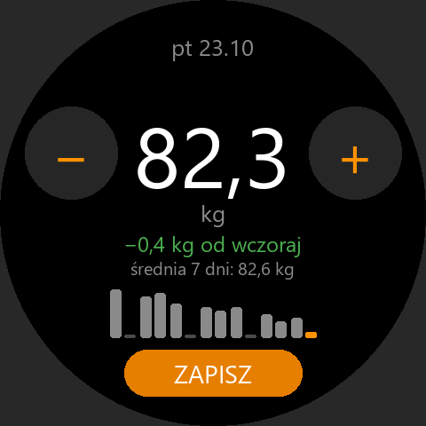

# Waga

Codzienne poranne ważenie na zegarku + aplikacja na telefon z wykresem, trendem, celem,
kaloriami i aktywnościami z Health Connect. Kontrakt danych: [SYNC.md](SYNC.md).

| Folder   | Co to                                                        | Stan            |
| -------- | ------------------------------------------------------------ | --------------- |
| `watch/` | Aplikacja Zepp OS na Amazfit T-Rex 3 (appId 1087168) + synchronizacja z Firestore | etapy 1–2 |
| `phone/` | Aplikacja Flutter: wykres wagi, trend, cel, kalorie, aktywności – [README](phone/README.md) | etapy 3–4 |

## Zegarek (`watch/`)



- Ekran startuje od **ostatniego pomiaru** – zwykle wystarczy kilka stuknięć **−** / **+** (0,1 kg).
- **Przytrzymanie** −/+ powtarza krok coraz szybciej. Przyciski zegarka **góra/dół** też zmieniają wagę.
- **ZAPISZ** zapisuje pomiar z dziś (jeden na dzień; ponowny zapis tego samego dnia – przycisk
  **POPRAW** – nadpisuje). Po zapisie liczba i napis **ZAPISANO** są zielone.
- Pod liczbą: zmiana od poprzedniego pomiaru (zielona = mniej, czerwona = więcej) i średnia z 7 dni.
- Wykres 14 dni (dziś na pomarańczowo, kreska = dzień bez pomiaru). **Stuknięcie w wykres** otwiera
  historię: zmiana w 7 i 30 dniach oraz lista pomiarów (do 60).
- Dane w pliku `waga.json` (+ `waga.bak`) w pamięci aplikacji (`@zos/fs`), w dziesiątych częściach kg.

Instalacja:

```
cd waga/watch
zeus preview
```

(wybierz „Amazfit T-Rex 3”, potem w Zepp: Profil → urządzenie → Ogólne → Tryb dewelopera → „+” → Skanuj).

Testy logiki: `npm test` w `waga/watch`. Ikona i podgląd: `python tools/gen_assets.py`.

## Dalej

5. Przypomnienie rano (`@zos/alarm`), eksport CSV, wydanie telefonu w sklepie rodzinnym
   (workflow `release-waga.yml`, sekret `FIREBASE_OPTIONS_WAGA_B64`).
