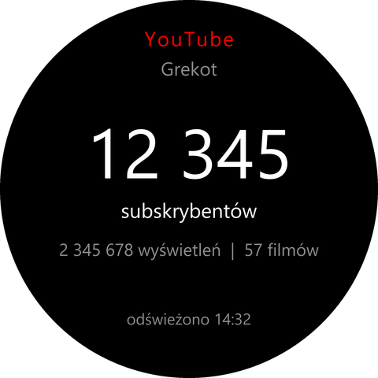
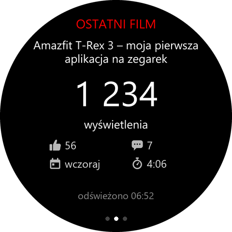

# YouTube Subs – statystyki kanału na Amazfit T-Rex 3

Trzy ekrany, przełączane przesunięciem palca w lewo/prawo:

1. **Kanał** – liczba subskrybentów, wyświetleń i filmów.
2. **Ostatni film** – tytuł, wyświetlenia, polubienia, komentarze, kiedy opublikowany, długość.
3. **Ostatni short** – to samo dla najnowszego Shorta.

 

Na ekranach filmu pod liczbą wyświetleń jest siatka ikon:

| Ikona | Znaczenie |
|---|---|
| kciuk w górę | polubienia (`ukryte`, jeśli autor je ukrył) |
| dymek | komentarze (`wyłączone`, jeśli autor je wyłączył) |
| kalendarz | kiedy opublikowano, w dniach kalendarzowych: `dzisiaj`, `wczoraj`, `3 dni temu`… (`NA ŻYWO` podczas transmisji) |
| stoper | długość filmu, np. `4:06` |

Ikony są w `assets/gt.r/icons/` (28 × 28 px, rysowane własnoręcznie).

Na dole są trzy kropki pokazujące, który ekran jest aktywny. Przesunięcie w prawo na
pierwszym ekranie zamyka aplikację (standardowy gest Zepp OS).

## Jak to działa

Zegarek nie ma internetu, więc aplikacja ma trzy części, wszystkie w tym projekcie:

| Część          | Gdzie działa              | Plik                   |
|----------------|---------------------------|------------------------|
| ekrany         | zegarek                   | `page/gt/home/`        |
| Side Service   | aplikacja Zepp (telefon)  | `app-side/index.js`    |
| ustawienia     | aplikacja Zepp (telefon)  | `setting/index.js`     |

Zegarek prosi telefon (`this.request`), Side Service odpytuje YouTube Data API v3
i odsyła komplet danych dla wszystkich ekranów. Ostatni wynik jest zapisywany w pamięci
zegarka, więc po uruchomieniu od razu coś widać, nawet bez połączenia z telefonem.

Jedno odświeżenie to 4 zapytania (4 jednostki z dziennego limitu 10 000):

| Zapytanie | Po co |
|---|---|
| `channels` | statystyki kanału |
| `playlistItems` dla playlisty `UULF…` | ID ostatniego długiego filmu |
| `playlistItems` dla playlisty `UUSH…` | ID ostatniego Shorta |
| `videos` | statystyki obu filmów naraz |

`UULF…` i `UUSH…` to playlisty systemowe YouTube (prefiks zamiast `UC` w ID kanału):
`UU` – wszystkie filmy, `UULF` – tylko długie, `UUSH` – tylko Shorts, `UULV` – transmisje.
Nie są oficjalnie udokumentowane, ale działają od lat; gdyby `UULF` przestało istnieć,
aplikacja wraca do zwykłej playlisty `UU`.

## Konfiguracja (jednorazowo)

1. [Google Cloud Console](https://console.cloud.google.com/): nowy projekt → włącz
   **YouTube Data API v3** → **Dane logowania → Utwórz klucz API**. Ogranicz klucz do
   tego jednego API.
2. ID kanału: [youtube.com/account_advanced](https://www.youtube.com/account_advanced)
   (zaczyna się od `UC`, 24 znaki).
3. Zainstaluj aplikację na zegarku (`zeus preview`, jak w pozostałych projektach).
4. W aplikacji Zepp na telefonie otwórz stronę zegarka, znajdź **YouTube Subs** na liście
   aplikacji i wpisz ID kanału oraz klucz API.
5. Otwórz aplikację na zegarku. Stuknięcie w ekran odświeża dane; automatycznie
   odświeżają się co 5 minut, gdy aplikacja jest otwarta.

## Komunikaty

| Komunikat                            | Znaczenie                                          |
|--------------------------------------|----------------------------------------------------|
| `stuknij, aby pobrać`                | brak danych w pamięci                              |
| `Pobieram...`                        | czeka na odpowiedź telefonu                        |
| `odświeżono 14:32`                   | dane aktualne                                      |
| `Brak połączenia z telefonem`        | zegarek nie dogadał się z aplikacją Zepp           |
| `Uzupełnij ustawienia w aplikacji Zepp` | brak ID kanału lub klucza                       |
| `Klucz API odrzucony: …`             | zły klucz albo wyczerpany limit                    |
| `Nie znaleziono kanału - sprawdź ID` | ID kanału nie istnieje                             |
| `Kanał nie ma shortów` (ekran 3)     | playlista Shorts jest pusta                        |
| `polubienia ukryte` / `komentarze wył.` | autor ukrył licznik lub wyłączył komentarze     |

Publiczne API zaokrągla liczbę subskrybentów powyżej 1000 do trzech cyfr znaczących.

## Testy (tylko Node.js)

```bash
npm test
```

Testują formatowanie liczb, czasu i polską odmianę (`utils/format.js`) oraz obsługę
odpowiedzi YouTube, w tym błędy i playlisty (`utils/youtube.js`).
